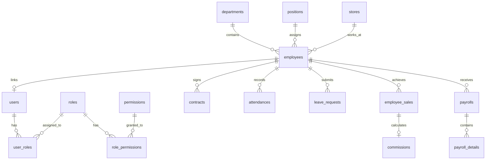
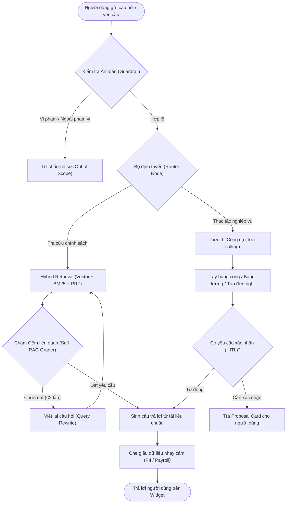

<p align="center">
  <a href="https://sgu.edu.vn/" title="Trường Đại học Sài Gòn (SGU)">
    
  </a>
</p>

<h1 align="center"><b>TechZone HRM - Hệ Thống Quản Lý Nhân Sự Chuỗi Cửa Hàng Bán Lẻ Thiết Bị Công Nghệ</b></h1>
<h3 align="center">Nền tảng Quản trị Nhân sự Đa nền tảng (Web & Mobile) tích hợp Chấm công Geofence, Phân ca kíp, Quản lý Lương Doanh số & Trợ lý AI Agentic RAG</h3>
<h4 align="center">Học phần: Hệ Thống Thông Tin Doanh Nghiệp (841065) & Công Nghệ Phần Mềm (841403)</h4>
<h4 align="center">Khoa Công Nghệ Thông Tin - Trường Đại học Sài Gòn (SGU)</h4>

<p align="center">
  
  
  
  
  
  
  
  
  
  
</p>

---

# **Tổng Quan Dự Án (Project Overview)**

> **TechZone HRM** là hệ sinh thái phần mềm quản trị nguồn nhân lực (Human Resource Management) chuyên biệt hóa cho mô hình chuỗi bán lẻ thiết bị công nghệ (**TechZone Retail**). Hệ thống số hóa 100% các quy trình nghiệp vụ nhân sự đa chi nhánh, ca kíp phức tạp và cơ chế đãi ngộ gắn liền với doanh số bán hàng:
>
> - **Cơ sở dữ liệu Quan hệ Chuẩn hóa 3NF:** Vận hành trên Supabase PostgreSQL với **51 bảng dữ liệu, 6 Views phân tích** và các Stored Procedures tính toán lương tự động ở mức cơ sở dữ liệu (`sp_calculate_monthly_commission`, `sp_generate_monthly_payroll`).
> - **Phân quyền RBAC Đa tầng & Nguyên tắc No Self-Approval:** Hệ thống thiết lập **5 vai trò chính** (`ADMIN`, `DIRECTOR`, `HR_MANAGER`, `STORE_MANAGER`, `EMPLOYEE`) cùng **18 quyền chức năng chi tiết** phân bổ theo 7 phân hệ. Cung cấp cơ chế duyệt chéo chống xung đột lợi ích: Đơn từ của HR và Admin bắt buộc phải được Ban Giám đốc (`DIRECTOR`) phê duyệt.
> - **Chấm công Đa phương thức & Định vị Geofence:** Quản lý 3 ca xoay (Sáng 08:00–16:00, Chiều 13:00–21:00, Full 08:00–21:00), xác thực vị trí thời gian thực qua **GPS Geofence bán kính 100m** bằng công thức Haversine, xác thực khuôn mặt bằng ảnh chụp Selfie tại quầy, cơ chế khóa nút Cooldown 60s và đối soát làm thêm giờ (OT Reconciliation) chặt chẽ.
> - **Quy trình Phê duyệt Đơn từ 2 Cấp (Two-level Approval Workflow):** Xét duyệt tuần tự hoặc phân cấp: Cửa hàng trưởng duyệt sơ bộ Cấp 1 $\rightarrow$ Trưởng phòng HR duyệt chính thức Cấp 2 $\rightarrow$ Giám đốc duyệt cấp cao cho các loại đơn: Phép năm, Nghỉ ốm đau, Thai sản, Nghỉ không lương, Làm thêm giờ (OT) và Đơn thôi việc kèm bàn giao tài sản.
> - **Tính lương Doanh số Bán lẻ & Tự động hóa Payroll:** Thuật toán tính lương bám sát thực tế: Công chuẩn 26 ngày, hoa hồng lũy kế theo nhóm thiết bị (Điện thoại & Laptop 1%, Phụ kiện 3%), thưởng vượt KPI doanh số (1.000.000đ – 2.000.000đ), phụ cấp chức vụ, thâm niên, dự án, trích nộp bảo hiểm 10.5% (BHXH 8%, BHYT 1.5%, BHTN 1%), thuế TNCN và bẻ nhỏ 12 cấu phần minh bạch vào `payroll_details`.
> - **Trợ lý AI Agentic RAG Doanh nghiệp:** Bộ máy **LangGraph + Mistral AI** với cơ chế tìm kiếm lai (Hybrid Search: Vector Embeddings + Full-text BM25 + Reciprocal Rank Fusion RRF), Self-RAG Grader, Guardrails chặn Prompt Injection/bảo vệ dữ liệu nhạy cảm PII, cùng Tool-calling hỗ trợ nhân viên tra cứu lương/công và tự động nộp đơn nghỉ phép qua hội thoại tự nhiên.
> - **Đa nền tảng Web Quản trị & Mobile Tác nghiệp:** Web Quản trị (React 19 + TypeScript + Vite) dành cho Quản lý & HR; Mobile App (React Native Expo) dành cho nhân viên bán lẻ tác nghiệp tại cửa hàng.

Hồ sơ đặc tả yêu cầu và ngữ cảnh master: **[`TECHZONE_HRM_MASTER_CONTEXT.md`](TECHZONE_HRM_MASTER_CONTEXT.md)** và **[`PRODUCT.md`](PRODUCT.md)**.  
Kế hoạch triển khai & quy trình thực thi: **[`HRM-Project-Workflow.md`](HRM-Project-Workflow.md)**.  
Báo cáo kiểm thử định lượng năng lực AI bằng Ragas: **[`backend/data/ragas_evaluation_report.json`](backend/data/ragas_evaluation_report.json)**.

---

## Thông Tin Nhóm Phát Triển (Team Information)

**Trường:** Đại học Sài Gòn (SGU) — Khoa Công nghệ Thông tin  
**Học phần:** Hệ thống thông tin doanh nghiệp (841065) & Công nghệ phần mềm (841403)  
**Đề tài:** Hệ thống HRM cho doanh nghiệp bán lẻ thiết bị công nghệ (TechZone HRM)

| STT | Mã số SV | Họ và tên | Vai trò trong dự án | Tài khoản GitHub | Email liên hệ |
|:---:|:---:|---|:---:|---|---|
| 1 | **3123411081** | **Lê Phan Nguyên Hải** | **Nhóm trưởng**|[VthongVthongVthong](https://github.com/VthongVthongVthong) | huynhvienthong979@gmail.com |
| 2 | **3123411287** | **Huỳnh Viễn Thông** | **Thành viên**| [lpnHai2005](https://github.com/lpnHai2005) ([HiCyclone](https://github.com/HiCyclone)) | lephannguyenhai@gmail.com |
| 3 | **3123411030** | **Võ Hoàng Bảo** | **Thành viên**| [hoangbao2908](https://github.com/hoangbao2908) | vohoangbao082005@gmail.com |
| 4 | **3123411166** | **Đoàn Trung Kiên** | **Thành viên**|[TrungKien2005](https://github.com/TrungKien2005) | doantrungkien.live@gmail.com |

> **Về đề tài này:** Toàn bộ hệ thống TechZone HRM được nghiên cứu và thiết kế độc lập bởi nhóm 4 sinh viên Khoa CNTT - SGU. Dự án tích hợp sâu giữa chuẩn mực nghiệp vụ quản trị nguồn nhân lực chuỗi bán lẻ hiện đại (Chuẩn hóa CSDL 3NF, phân quyền RBAC phân cấp, tính lương theo doanh số sản phẩm) với công nghệ phần mềm tiên tiến (FastAPI Async, React 19, Expo Router, Agentic RAG LLM với Mistral AI & LangGraph).

---

## **Mục Lục (Table of Contents)**

- [Cấu Trúc Thư Mục](#cấu-trúc-thư-mục)
- [Bài Toán & Bối Cảnh Nghiệp Vụ](#bài-toán--bối-cảnh-nghiệp-vụ)
- [Thiết Kế Cơ Sở Dữ Liệu (Database Architecture)](#thiết-kế-cơ-sở-dữ-liệu-database-architecture)
  - [1. Danh mục 51 Bảng Dữ Liệu Theo Phân Hệ](#1-danh-mục-51-bảng-dữ-liệu-theo-phân-hệ)
  - [2. Danh mục 6 Views Cơ Sở Dữ Liệu](#2-danh-mục-6-views-cơ-sở-dữ-liệu)
  - [3. Stored Procedures & Database Functions Cốt Lõi](#3-stored-procedures--database-functions-cốt-lõi)
- [Hệ Thống Phân Quyền Bảo Mật (RBAC System)](#hệ-thống-phân-quyền-bảo-mật-rbac-system)
  - [1. Danh mục 5 Vai Trò Cốt Lõi (Roles)](#1-danh-mục-5-vai-trò-cốt-lõi-roles)
  - [2. Danh mục 18 Quyền Chức Năng Chi Tiết (Permissions)](#2-danh-mục-18-quyền-chức-năng-chi-tiết-permissions)
  - [3. Ma Trận Phân Quyền Chi Tiết (RBAC Matrix)](#3-ma-trận-phân-quyền-chi-tiết-rbac-matrix)
  - [4. Cơ Chế Phê Duyệt Không Tự Duyệt (No Self-Approval Principle)](#4-cơ-chế-phê-duyệt-không-tự-duyệt-no-self-approval-principle)
- [Tổng Quan Kiến Trúc & Công Nghệ](#tổng-quan-kiến-trúc--công-nghệ)
  - [1. Backend API (FastAPI & SQLAlchemy 2.0 Async)](#1-backend-api-fastapi--sqlalchemy-20-async)
  - [2. Frontend Web Portal (React 19 & TypeScript)](#2-frontend-web-portal-react-19--typescript)
  - [3. Mobile Application (React Native & Expo Router)](#3-mobile-application-react-native--expo-router)
  - [4. AI Chatbot Engine (LangGraph & Agentic RAG)](#4-ai-chatbot-engine-langgraph--agentic-rag)
- [Tính Năng Nổi Bật](#tính-năng-nổi-bật)
- [Tài Khoản Đăng Nhập Mẫu (Seed Accounts)](#tài-khoản-đăng-nhập-mẫu-seed-accounts)
- [Cài Đặt & Hướng Dẫn Khởi Chạy](#cài-đặt--hướng-dẫn-khởi-chạy)
- [Tài Liệu API & Quy Trình Kiểm Thử](#tài-liệu-api--quy-trình-kiểm-thử)
- [Kết Quả Đánh Giá & Benchmark Ragas](#kết-quả-đánh-giá--benchmark-ragas)
- [Quy Ước Code (Coding Conventions)](#quy-ước-code-coding-conventions)
- [Hạn Chế & Hướng Phát Triển Tiếp Theo](#hạn-chế--hướng-phát-triển-tiếp-theo)
- [Giấy Phép Bản Quyền (License)](#giấy-phép-bản-quyền-license)
- [Tài Liệu Tham Khảo](#tài-liệu-tham-khảo)

---

## **Cấu Trúc Thư Mục**

```text
SGU_HRM-Project/
├── README.md                          # Tài liệu chính giới thiệu dự án (File này)
├── run.py                             # Script Python điều phối kiểm tra phụ thuộc và chạy song song Web + API
├── requirements.txt                   # Phụ thuộc Python ở cấp thư mục gốc (-r backend/requirements.txt)
├── TECHZONE_HRM_MASTER_CONTEXT.md     # Ngữ cảnh Master toàn dự án (Quy định lương, kiến trúc, phân công)
├── PRODUCT.md                         # Đặc tả sản phẩm, vai trò, nghiệp vụ và quy định thương hiệu
├── HRM-Project-Workflow.md            # Kế hoạch thực thi 5 tuần, thiết kế DB và ma trận RBAC ban đầu
├── Nhóm HTTT.docx                     # Đề cương đồ án môn học nhóm HTTT (SGU)
├── LICENSE                            # Giấy phép bản quyền mã nguồn mở MIT
│
├── backend/                           # Phân hệ Backend FastAPI
│   ├── app/
│   │   ├── api/
│   │   │   ├── deps.py                # Dependencies kiểm tra JWT, RBAC Role Checker, Strict RBAC, Audit Log
│   │   │   └── v1/
│   │   │       ├── router.py          # Bộ định tuyến API tập trung
│   │   │       └── endpoints/         # 18 Tuyến API phân hệ nghiệp vụ:
│   │   │           ├── auth.py        # Đăng nhập, /me, đổi mật khẩu, danh sách test accounts
│   │   │           ├── users.py       # Quản trị tài khoản người dùng, kích hoạt/khóa tài khoản
│   │   │           ├── roles.py       # Danh mục Roles, Permissions và Ma trận RBAC Matrix
│   │   │           ├── employees.py   # Hồ sơ nhân sự, hợp đồng, thăng chức tự đổi quyền
│   │   │           ├── stores.py      # Mạng lưới cửa hàng, cấu hình Geofence tọa độ GPS
│   │   │           ├── attendances.py # Chấm công, giám sát vào/ra ca, bảng công tháng
│   │   │           ├── work_schedules.py # Phân ca tuần, đăng ký ca làm, đổi ca
│   │   │           ├── fixed_schedules.py # Quản lý quy tắc phân ca cố định theo thứ
│   │   │           ├── overtime_requests.py # Đăng ký làm thêm giờ (OT) và phê duyệt
│   │   │           ├── overtime_reconciliations.py # Đối soát giờ công OT thực tế vs đăng ký
│   │   │           ├── leaves.py      # Đơn nghỉ phép & quy trình duyệt 2 cấp (Store -> HR/Director)
│   │   │           ├── resignations.py # Đơn xin thôi việc và quy trình bàn giao tài sản
│   │   │           ├── payrolls.py    # Ghi nhận doanh số, tính hoa hồng, chốt lương, in phiếu lương
│   │   │           ├── reports.py     # Báo cáo biến động nhân sự, cơ cấu đa chiều, quỹ lương
│   │   │           ├── audit_logs.py  # Nhật ký hoạt động toàn diện (Old Values / New Values JSONB)
│   │   │           ├── mobile_attendance.py # API chuyên dụng cho chấm công trên ứng dụng di động
│   │   │           ├── operations.py  # Điều hành tác nghiệp nhanh chi nhánh
│   │   │           └── ai_chatbot.py  # Endpoint hỏi đáp AI Chatbot & Agentic Tool Execution
│   │   ├── core/
│   │   │   ├── config.py              # Cấu hình biến môi trường Pydantic Settings
│   │   │   ├── database.py            # Kết nối PostgreSQL bất đồng bộ (SQLAlchemy AsyncSession)
│   │   │   ├── security.py            # Mã hóa mật khẩu bcrypt, phát hành & kiểm tra JWT Token
│   │   │   ├── ai_chatbot_graph.py    # Bộ máy LangGraph StateGraph (Router, Retriever, Grader, Tools)
│   │   │   ├── ai_chatbot_tools.py    # Công cụ nghiệp vụ cho AI (Tạo đơn phép, tra cứu bảng lương)
│   │   │   ├── ai_chatbot_db.py       # Lưu trữ ngữ cảnh hội thoại và lịch sử phiên chat
│   │   │   ├── ai_chatbot_cache.py    # Bộ nhớ đệm Policy Cache và Redis caching
│   │   │   ├── contract_pdf.py        # Xuất hợp đồng lao động điện tử sang định dạng PDF
│   │   │   ├── excel_exporter.py      # Xuất báo cáo thống kê nhân sự và công lương sang Excel
│   │   │   └── storage.py             # Dịch vụ upload và lưu trữ hình ảnh đám mây Cloudinary
│   │   ├── models/
│   │   │   └── entities.py            # Định nghĩa các Thực thể ORM SQLAlchemy
│   │   └── schemas/
│   │       └── schemas.py             # Schema kiểm thực dữ liệu vào/ra bằng Pydantic v2
│   ├── data/
│   │   ├── knowledge_base_pdfs/       # Tập tài liệu quy chế nội bộ PDF phục vụ Vector Store RAG
│   │   └── ragas_evaluation_report.json # Kết quả đánh giá định lượng năng lực AI bằng Ragas
│   ├── fixtures/                      # Các kịch bản fixture kiểm thử nâng cao và đối soát OT
│   ├── migrations/                    # 30 tập tin SQL Migration DDL cập nhật lược đồ CSDL
│   ├── scripts/
│   │   ├── generate_knowledge_pdfs.py # Script sinh văn bản pháp quy, nội quy lao động PDF chuẩn A4
│   │   ├── ingest_pdfs_to_vectorstore.py # Script nạp dữ liệu tri thức vào Vector Store Supabase
│   │   ├── evaluate_ragas.py          # Kịch bản kiểm thử tự động bộ số liệu Benchmark Ragas
│   │   └── load_test_chatbot.py       # Script kiểm thử tải chịu lực và độ trễ AI Chatbot
│   ├── tests/                         # Thư mục kiểm thử tự động pytest (35 test suites hoàn tất)
│   ├── Dockerfile                     # Cấu hình đóng gói container Docker cho Backend
│   ├── requirements.txt               # Danh sách thư viện Python phụ thuộc của Backend
│   └── run.py                         # File thực thi máy chủ Uvicorn
│
├── frontend-web/                      # Phân hệ Web Quản trị (React 19 + TypeScript + Vite)
│   ├── src/
│   │   ├── components/
│   │   │   ├── common/                # Thành phần UI dùng chung (Button, StatCard, Badge, EmptyState...)
│   │   │   ├── layout/                # Khung giao diện: Sidebar điều hướng, Topbar thông tin, BottomNav
│   │   │   ├── ai/                    # Trợ lý ảo AI: AiChatbotWidget.tsx, AiChatbotWidget.css
│   │   │   ├── charts/                # Biểu đồ phân tích và thống kê (Recharts)
│   │   │   ├── reports/               # Thành phần xem và in báo cáo (ReportsPrintModal.tsx)
│   │   │   └── schedule/              # Thành phần phân ca và xem lịch làm việc
│   │   ├── pages/                     # 25 Màn hình chức năng quản lý chuyên sâu:
│   │   │   ├── DashboardPage.tsx      # Tổng quan tình hình nhân sự, quân số, quỹ lương
│   │   │   ├── EmployeeListPage.tsx   # Danh sách và hồ sơ chi tiết nhân viên
│   │   │   ├── ContractManagementPage.tsx # Quản lý hợp đồng lao động và phụ lục
│   │   │   ├── StoreManagementPage.tsx # Quản trị cửa hàng, định vị Geofence trên bản đồ
│   │   │   ├── AttendancePage.tsx     # Bảng theo dõi chấm công ngày theo thời gian thực
│   │   │   ├── MonthlyAttendancePage.tsx # Bảng công tổng hợp tháng của nhân sự
│   │   │   ├── WorkSchedulesPage.tsx  # Quản lý phân ca làm việc chi nhánh
│   │   │   ├── OvertimeRequestsPage.tsx # Tiếp nhận và phê duyệt làm thêm giờ
│   │   │   ├── LeaveRequestsPage.tsx  # Quản lý phê duyệt đơn nghỉ phép 2 cấp
│   │   │   ├── ResignationManagementPage.tsx # Quản trị thôi việc và bàn giao
│   │   │   ├── PayrollPage.tsx        # Bảng tính lương tháng, hoa hồng bán lẻ, chốt lương
│   │   │   ├── MyPayslipPage.tsx      # Tra cứu phiếu lương chi tiết cá nhân & giải trình công thức
│   │   │   ├── ProjectsPage.tsx       # Quản lý dự án nội bộ và phụ cấp thành viên
│   │   │   ├── ReportsPage.tsx        # Báo cáo phân tích biểu đồ & xuất file
│   │   │   ├── AuditLogPage.tsx       # Nhật ký kiểm toán hệ thống
│   │   │   ├── UserAccessPage.tsx     # Quản lý tài khoản và ma trận phân quyền người dùng
│   │   │   └── LoginPage.tsx          # Màn hình đăng nhập hệ thống
│   │   ├── services/                  # Các lớp API Client (Axios wrapper, Token Interceptor)
│   │   ├── contexts/                  # React Contexts (AuthContext, ThemeContext)
│   │   ├── utils/                     # Tiện ích định dạng tiền tệ VNĐ, ngày giờ, xuất PDF
│   │   ├── App.tsx                    # Định tuyến ứng dụng React Router v7
│   │   └── App.css                    # Hệ thống định kiểu CSS Enterprise Theme (Light/Dark mode)
│   ├── package.json                   # Cấu hình gói và thư viện Web
│   └── vite.config.ts                 # Cấu hình trình đóng gói Vite
│
├── mobile/                            # Phân hệ Mobile App (React Native & Expo Router)
│   ├── src/
│   │   ├── app/                       # File-based routing theo Expo Router:
│   │   │   ├── (staff)/               # Nhóm màn hình tác nghiệp cho nhân viên bán lẻ:
│   │   │   │   ├── dashboard.tsx      # Trang chủ: Thẻ công nhanh, ca làm việc hôm nay
│   │   │   │   ├── attendance.tsx     # Chấm công GPS Geofence + chụp ảnh Selfie tại quầy
│   │   │   │   ├── schedules.tsx      # Xem lịch làm việc phân ca theo tuần
│   │   │   │   ├── requests.tsx       # Tạo và theo dõi tiến trình duyệt đơn nghỉ phép / OT
│   │   │   │   ├── summary.tsx        # Tra cứu tổng hợp ngày công và thu nhập tháng
│   │   │   │   └── account.tsx        # Cập nhật thông tin cá nhân và cài đặt ứng dụng
│   │   │   └── login.tsx              # Màn hình đăng nhập di động
│   │   ├── services/                  # Dịch vụ GPS Geofence, chụp ảnh, gửi API chấm công
│   │   └── contexts/                  # Quản lý phiên làm việc, định vị và thông báo
│   ├── app.json                       # Cấu hình Expo Application
│   └── package.json                   # Danh mục thư viện ứng dụng di động
│
└── docs/                              # Tài nguyên tri thức và tài liệu tham chiếu
    └── knowledge_base_sources/        # 8 văn bản quy chế chuẩn hóa làm nguồn tri thức cho AI RAG
```

---

## **Bài Toán & Bối Cảnh Nghiệp Vụ**

Tại chuỗi cửa hàng bán lẻ thiết bị công nghệ TechZone, các hoạt động quản trị nguồn nhân lực phải đối mặt với các bài toán đặc thù của ngành bán lẻ:

1. **Vận hành phân tán đa chi nhánh & Phân ca kíp phức tạp:** Các cửa hàng Flagship (Quận 1, Quận 3, Quận 6, Bình Thạnh, Tân Bình...) mở cửa từ 08:00 đến 21:00 hàng ngày, tổ chức thành 3 ca xoay:
   - **Ca Sáng:** 08:00 – 16:00
   - **Ca Chiều:** 13:00 – 21:00
   - **Ca Full:** 08:00 – 21:00
   Nhân viên thường xuyên chuyển đổi ca, làm thêm giờ (OT) hoặc nhận lệnh tăng cường giữa các cửa hàng. Việc chấm công bằng vân tay truyền thống hay sổ sách thủ công bộc lộ nhiều kẽ hở, khó phát hiện gian lận và tốn hàng tuần đối soát ngày công cuối tháng.
2. **Quy tắc trễ giờ & Giảm trừ lương theo thời gian:**
   - Ân hạn điểm danh (Grace Period): Nhân viên được phép check-in trong vòng 15 phút đầu ca (Ví dụ: Ca sáng 08:00, check-in trước hoặc đúng 08:15 được tính đúng giờ).
   - Đi muộn sau phút thứ 15: Bị đánh dấu `LATE`, phạt vi phạm nội quy 50.000đ/lần và bị trừ lương cơ bản theo phút vắng mặt.
   - Đi muộn trên 60 phút: Trừ 0.5 ngày công thực tế.
3. **Thu nhập gắn liền doanh số bán thiết bị (Hoa hồng công nghệ):** Thu nhập của nhân viên bán lẻ bao gồm:
   - Hoa hồng Điện thoại & Laptop: **1.0%** doanh số.
   - Hoa hồng Linh phụ kiện biên lợi nhuận cao: **3.0%** doanh số.
   - Thưởng vượt chỉ tiêu KPI: Đạt $\ge 100\%$ thưởng nóng **1.000.000đ**; Đạt $\ge 120\%$ thưởng nóng **2.000.000đ**.
   - Khấu trừ nghỉ không lương: `(Lương HĐ / 26) × Ngày nghỉ`.
4. **Quy trình phê duyệt phân cấp & Chống tự duyệt (No Self-Approval):**
   - Đơn xin nghỉ phép, nghỉ ốm, thai sản của nhân viên chi nhánh: Cửa hàng trưởng (Cấp 1) duyệt sơ bộ về quân số $\rightarrow$ Trưởng phòng HR (Cấp 2) duyệt chính thức về mặt quy chế.
   - Đơn xin nghỉ phép của HR Manager hoặc Admin: **Tuyệt đối không được tự duyệt cho bản thân** mà phải được chuyển lên Ban Giám đốc (`DIRECTOR`) xét duyệt.

---

## **Thiết Kế Cơ Sở Dữ Liệu (Database Architecture)**

Cơ sở dữ liệu của hệ thống được xây dựng trên **Supabase Cloud (PostgreSQL 15+)** với cấu trúc chuẩn hóa mức **3NF (Third Normal Form)**, gồm **51 bảng dữ liệu, 6 Views phân tích và các Stored Procedures / Functions** chuyên biệt:

### 1. Danh mục 51 Bảng Dữ Liệu Theo Phân Hệ



| STT | Phân hệ nghiệp vụ | Tên bảng dữ liệu | Mục đích và nội dung lưu trữ |
|:---:|---|---|---|
| 1 | **Phân quyền & Kiểm soát truy cập (RBAC)** | `roles` | Danh mục 5 vai trò hệ thống: `ADMIN`, `DIRECTOR`, `HR_MANAGER`, `STORE_MANAGER`, `EMPLOYEE`. |
| 2 | | `permissions` | Danh mục 18 quyền hạn chức năng chi tiết theo từng module nghiệp vụ. |
| 3 | | `role_permissions` | Bảng liên kết N-N xác định quyền chức năng của từng vai trò. |
| 4 | | `user_roles` | Bảng liên kết N-N gán vai trò cho người dùng (hỗ trợ 1 user có nhiều role). |
| 5 | | `users` | Tài khoản đăng nhập, mật khẩu băm bcrypt, trạng thái kích hoạt, liên kết với nhân sự. |
| 6 | | `audit_logs` | Nhật ký thanh tra lưu toàn bộ hành động (Action, Entity, `old_values` và `new_values` JSONB, IP). |
| 7 | **Cơ cấu Tổ chức & Định danh** | `departments` | Danh mục phòng ban trực thuộc (Ban Giám đốc, Phòng HR, Kế toán, Khối Cửa hàng...). |
| 8 | | `stores` | Danh mục các chi nhánh cửa hàng TechZone (Địa chỉ, số điện thoại, ngày mở cửa). |
| 9 | | `education_levels` | Danh mục trình độ học vấn (Đại học, Cao đẳng, Trung cấp, THPT...). |
| 10 | | `positions` | Danh mục vị trí chức danh, hệ số chức vụ, định mức phụ cấp và khoảng lương cơ bản. |
| 11 | **Hồ sơ Nhân sự & Hợp đồng** | `employees` | Bảng thực thể trung tâm: CCCD, thông tin liên lạc, mã nhân viên `TZ-xxx`, cột tự sinh `full_name`. |
| 12 | | `contracts` | Hợp đồng lao động điện tử: Mã `HDLD-TZ-xxx-yyyy`, loại HĐ, lương cơ bản, lương đóng BH. |
| 13 | | `position_histories` | Lịch sử bổ nhiệm, điều chuyển cửa hàng và thăng chức của nhân viên. |
| 14 | | `resignation_requests` | Hồ sơ đơn xin thôi việc, biên bản bàn giao thiết bị, thanh lý hợp đồng. |
| 15 | **Chấm công & Định vị Geofence** | `work_shifts` | Danh mục 3 ca làm việc (Ca Sáng, Ca Chiều, Ca Full). |
| 16 | | `work_schedules` | Lịch phân ca chi nhánh (Unique ràng buộc: `employee_id` + `work_date`). |
| 17 | | `work_schedule_audits` | Nhật ký kiểm toán lịch sử điều chỉnh phân ca. |
| 18 | | `fixed_schedule_rules` | Quy tắc phân ca cố định theo ngày trong tuần của chi nhánh. |
| 19 | | `fixed_schedule_audits` | Lịch sử sửa đổi các quy tắc phân ca cố định. |
| 20 | | `attendances` | Dữ liệu chấm công hàng ngày: Giờ vào, giờ ra, số phút trễ, về sớm, giờ OT, trạng thái ngày công. |
| 21 | | `attendance_photo_proofs` | Ảnh chụp selfie xác thực khuôn mặt lúc check-in/out tại cửa hàng. |
| 22 | | `mobile_attendance_proofs` | Bằng chứng điểm danh từ ứng dụng di động kèm tọa độ GPS và thiết bị. |
| 23 | | `store_geofences` | Tọa độ GPS ranh giới ảo cửa hàng (Latitude, Longitude, Radius mét). |
| 24 | | `mobile_store_geofences` | Cấu hình Geofence đồng bộ dành riêng cho ứng dụng di động. |
| 25 | | `store_web_attendance_networks`| Cấu hình dải mạng IP / Wi-Fi điểm danh tại quầy POS cửa hàng. |
| 26 | | `attendance_overtime_approvals`| Bản ghi phê duyệt làm thêm giờ gắn liền với phiên chấm công. |
| 27 | **Quản lý Làm thêm giờ (Overtime - OT)**| `overtime_requests` | Đơn đăng ký làm thêm giờ của nhân viên trước hoặc sau ca làm việc. |
| 28 | | `overtime_request_events` | Chuỗi sự kiện trạng thái đơn OT (State Machine Append-Only). |
| 29 | | `overtime_reconciliations` | Dữ liệu đối soát giữa giờ làm thêm đăng ký và thời gian thực tế ghi nhận trên bảng công. |
| 30 | | `overtime_reconciliation_cases` | Hồ sơ giải quyết các trường hợp bất thường hoặc sai lệch giờ OT. |
| 31 | | `overtime_reconciliation_events`| Nhật ký sự kiện đối soát OT bất biến (Append-Only Audit). |
| 32 | | `overtime_reconciliation_case_events`| Nhật ký chi tiết tiến trình xử lý vụ việc đối soát OT. |
| 33 | **Nghỉ phép & Đơn từ 2 Cấp** | `leave_types` | Danh mục loại phép: `ANNUAL` (Phép năm), `SICK` (Ốm đau), `MATERNITY` (Thai sản), `UNPAID` (Không lương). |
| 34 | | `leave_requests` | Đơn xin nghỉ phép với các trường định danh người duyệt Cấp 1, Cấp 2 và Giám đốc. |
| 35 | **Doanh số, Tiền lương & Hoa hồng** | `employee_sales` | Doanh thu bán lẻ 3 ngành hàng (Điện thoại, Laptop, Phụ kiện) và tỷ lệ đạt KPI. |
| 36 | | `commissions` | Tiền hoa hồng chi tiết được trích theo tỷ lệ sản phẩm công nghệ. |
| 37 | | `payrolls` | Bảng lương tháng tổng hợp: Lương CB, OT, phụ cấp, hoa hồng, bảo hiểm, phạt, Net thực lĩnh. |
| 38 | | `payroll_details` | Chi tiết 12 cấu phần công thức tính lương của từng nhân viên phục vụ tra cứu minh bạch. |
| 39 | | `payroll_calculation_runs` | Nhật ký các phiên chạy chốt lương toàn chuỗi. |
| 40 | | `payroll_manual_adjustments` | Các khoản điều chỉnh lương bổ sung thủ công có lý do phê duyệt. |
| 41 | | `payroll_period_bonuses` | Các khoản tiền thưởng theo kỳ (Thưởng lễ theo hệ số chức vụ, thưởng nóng KPI). |
| 42 | | `payroll_policy_settings` | Bảng cấu hình các thông số chính sách lương động toàn hệ thống. |
| 43 | **Quản trị Dự án & Phụ cấp** | `projects` | Danh mục các dự án nâng cấp kinh doanh và mở điểm bán mới. |
| 44 | | `project_roles` | Danh mục vai trò trong dự án: `PROJECT_MANAGER`, `CORE_MEMBER`, `MEMBER`. |
| 45 | | `project_role_allowances` | Định mức tiền phụ cấp hàng tháng theo từng vai trò dự án. |
| 46 | | `project_members` | Danh sách nhân viên tham gia dự án và phụ cấp được nhận. |
| 47 | **Thông báo & Tương tác** | `notifications` | Hộp thư thông báo hệ thống gửi đến người dùng. |
| 48 | | `notification_reads` | Trạng thái đã đọc thông báo của người dùng. |
| 49 | **Trí tuệ Nhân tạo (AI RAG)** | `policy_embeddings` | Bảng vector lưu trữ các đoạn văn bản quy chế (`pgvector`, `mistral-embed-2312` 1024 chiều). |
| 50 | | `ai_chat_messages` | Lịch sử tin nhắn hội thoại giữa nhân viên và trợ lý ảo AI. |
| 51 | | `ai_chat_action_proposals` | Đề xuất hành động nghiệp vụ có xác nhận của con người (HITL Action Proposals). |

---

### 2. Danh mục 6 Views Cơ Sở Dữ Liệu

Hệ thống tối ưu hóa hiệu năng truy vấn và kết xuất báo cáo thông qua 6 Views quản trị:
1. **`v_annual_salary_summary`**: Tổng hợp thu nhập 12 tháng của nhân viên (Tổng Gross, Tổng Net, Tổng Bảo hiểm, Tổng Thuế TNCN) phục vụ quyết toán thuế và in phiếu lương năm chuẩn A4.
2. **`v_monthly_hr_status_report`**: Thống kê biến động nhân sự hàng tháng theo trạng thái (`ACTIVE`, `PROBATION`, `ON_LEAVE`, `RESIGNED`), tỷ trọng biên chế và biểu đồ tuyển dụng.
3. **`v_hr_demographics_report`**: Phân tích cơ cấu nhân sự đa chiều phục vụ biểu đồ Dashboard: Theo trình độ học vấn, theo thâm niên làm việc và theo 4 khung bậc mức lương.
4. **`v_user_active_permissions`**: Phân giải tự động toàn bộ quyền chức năng hiệu lực của người dùng dựa trên tất cả các vai trò được gán, loại bỏ trùng lặp.
5. **`v_attendance_photo_proof_monitor`**: Giám sát bằng chứng ảnh chụp selfie khi check-in/out đối chiếu với tọa độ GPS Geofence.
6. **`v_overtime_verified_current`**: Bảng tổng hợp các giờ làm thêm OT đã được xác thực và đối soát hợp lệ trong kỳ lương hiện hành.

---

### 3. Stored Procedures & Database Functions Cốt Lõi

Toàn bộ logic tính toán tài chính nhạy cảm được đóng gói thành các hàm và thủ tục lưu trữ (Stored Procedures) thực thi trực tiếp trong PostgreSQL:

- **`sp_calculate_monthly_commission(period VARCHAR)`**:  
  Tự động duyệt qua toàn bộ bản ghi bán hàng trong kỳ `period`, tính hoa hồng lũy kế (1% Điện thoại, 1% Laptop, 3% Phụ kiện) và thưởng nóng KPI (1.000.000đ khi đạt 100%, 2.000.000đ khi đạt 120%), sau đó ghi vào bảng `commissions`.
- **`sp_generate_monthly_payroll(period VARCHAR, hr_id INT)`**:  
  Thủ tục chốt lương toàn chuỗi: Tính số ngày công chuẩn (26 ngày), trừ lương do vắng mặt/đi trễ (`time_deduction_amount`), cộng tiền OT, cộng 3 loại phụ cấp (chức vụ, thâm niên, dự án), cộng 2 loại thưởng (thưởng lễ theo hệ số `holiday_bonus = 1.000.000đ × position_coefficient`, thưởng KPI), trừ bảo hiểm bắt buộc 10.5%, trừ phạt đi muộn, trừ thuế TNCN và tự động sinh 12 dòng giải trình toán học vào `payroll_details`.
- **`fn_verify_store_geofence(p_store_id, p_lat, p_lng, p_radius)`**:  
  Hàm tính toán khoảng cách Haversine giữa tọa độ GPS của thiết bị điểm danh và tọa độ gốc của cửa hàng trên mặt cầu Trái Đất, trả về kết quả hợp lệ nếu trong bán kính quy định.
- **`match_policy_documents_mistral(query_embedding, match_threshold, match_count)`**:  
  Hàm tìm kiếm tương đồng Cosine Similarity trên bảng `policy_embeddings` phục vụ truy xuất tài liệu quy chế cho Trợ lý AI.

---

## **Hệ Thống Phân Quyền Bảo Mật (RBAC System)**

Hệ thống triển khai cơ chế kiểm soát truy cập dựa trên vai trò (**Role-Based Access Control - RBAC**) đa tầng, phân định rành mạch quyền hạn giữa các bộ phận:

### 1. Danh mục 5 Vai Trò Cốt Lõi (Roles)

| Mã vai trò (`role_code`) | Tên vai trò | Trách nhiệm và quyền hạn thực tế trong doanh nghiệp TechZone |
|---|---|---|
| **`ADMIN`** | **Quản trị viên hệ thống** | Quản trị toàn diện hệ thống: Quản lý tài khoản người dùng, cấu hình tham số, phân quyền vai trò và tra cứu toàn bộ `audit_logs`. Có quyền tối cao bypass qua tất cả các chốt kiểm tra quyền. |
| **`DIRECTOR`** | **Giám đốc điều hành** | Quản lý cấp cao nhất thuộc Ban Giám đốc (BOD). Xem toàn bộ nhân sự, xem bảng lương toàn chuỗi, xem báo cáo quản trị và **chịu trách nhiệm phê duyệt đơn nghỉ phép / đơn thôi việc của HR Manager và Admin** (giải quyết nguyên tắc *No Self-Approval*). |
| **`HR_MANAGER`** | **Trưởng phòng Nhân sự** | Quản lý toàn bộ hồ sơ nhân sự, hợp đồng lao động, thăng chức/điều chuyển, theo dõi bảng công chuỗi, phê duyệt đơn nghỉ phép cấp công ty (Cấp 2), điều hành tính toán và chốt bảng lương tháng, xuất báo cáo nhân sự. |
| **`STORE_MANAGER`** | **Cửa hàng trưởng** | Quản lý nhân sự tại chi nhánh phụ trách: Phân ca làm việc tuần, theo dõi chấm công cửa hàng, duyệt sơ bộ đơn từ của nhân viên chi nhánh (Cấp 1), nhập doanh số bán hàng chi nhánh và thực hiện chấm công cá nhân. |
| **`EMPLOYEE`** | **Nhân viên bán lẻ / Kỹ thuật** | Nhân viên tác nghiệp tại cửa hàng: Chấm công GPS Geofence + chụp selfie, xem lịch làm việc cá nhân, nộp đơn nghỉ phép / đăng ký OT, theo dõi doanh số cá nhân, tra cứu và in phiếu lương hàng tháng. |

---

### 2. Danh mục 18 Quyền Chức Năng Chi Tiết (Permissions)

Toàn bộ chức năng của hệ thống được module hóa thành **18 quyền hạn độc lập** thuộc 7 phân hệ:

| Phân hệ (Module) | Mã quyền (`permission_code`) | Tên quyền chức năng |
|---|---|---|
| **`[ATTENDANCE]`** | `attendance:record` | Chấm công check-in / check-out tại cửa hàng |
| | `attendance:manage_store` | Theo dõi và quản lý bảng chấm công chi nhánh cửa hàng |
| **`[EMPLOYEE]`** | `employee:create` | Thêm mới hồ sơ nhân sự vào hệ thống |
| | `employee:update` | Cập nhật hồ sơ nhân sự, thăng chức, điều chuyển chi nhánh |
| | `employee:delete` | Sa thải / chấm dứt hợp đồng nhân sự (`RESIGNED`) |
| | `employee:view_all` | Xem danh sách toàn bộ hồ sơ nhân sự toàn chuỗi |
| **`[LEAVE]`** | `leave:create` | Nộp đơn xin nghỉ phép, nghỉ ốm, thai sản, thôi việc, OT |
| | `leave:approve_store` | Cửa hàng trưởng phê duyệt sơ bộ đơn từ chi nhánh (Cấp 1) |
| | `leave:approve_hr` | Phê duyệt đơn từ chính thức cấp công ty (Cấp 2 / Giám đốc) |
| **`[PAYROLL]`** | `payroll:calculate` | Chốt ngày công và thực thi thủ tục tính toán bảng lương tháng |
| | `payroll:view_own` | Xem và in phiếu lương cá nhân theo tháng / năm |
| | `payroll:view_all` | Xem và xuất báo cáo quỹ lương toàn chuỗi chi nhánh |
| **`[REPORT]`** | `report:hr_monthly` | Xem báo cáo biến động nhân sự tháng (Active, On-leave, Resigned) |
| | `report:demographics` | Xem báo cáo phân tích cơ cấu (Học vấn, thâm niên, mức lương) |
| **`[STORE]`** | `store:view_own` | Xem nhân viên và dữ liệu thuộc chi nhánh mình phụ trách |
| **`[SYSTEM]`** | `user:manage` | Quản lý tài khoản người dùng hệ thống (Tạo, khóa, kích hoạt) |
| | `role:assign` | Phân quyền vai trò người dùng trong hệ thống |
| | `audit:view` | Truy cập và tra cứu nhật ký kiểm toán hệ thống (`audit_logs`) |

---

### 3. Ma Trận Phân Quyền Chi Tiết (RBAC Matrix)

Dưới đây là ma trận phân quyền thực tế được truy vấn trực tiếp từ bảng `role_permissions` trong cơ sở dữ liệu Supabase:

| Phân hệ | Quyền chức năng (`permission_code`) | `ADMIN` | `DIRECTOR` | `HR_MANAGER` | `STORE_MANAGER` | `EMPLOYEE` |
|---|---|:---:|:---:|:---:|:---:|:---:|
| **ATTENDANCE** | `attendance:record` (Chấm công vào/ra) | ✅ | ❌ | ❌ | ✅ | ✅ |
| | `attendance:manage_store` (Quản lý công cửa hàng) | ✅ | ❌ | ✅ | ✅ | ❌ |
| **EMPLOYEE** | `employee:create` (Thêm nhân viên mới) | ✅ | ❌ | ✅ | ❌ | ❌ |
| | `employee:update` (Cập nhật/Điều chuyển/Thăng chức) | ✅ | ❌ | ✅ | ❌ | ❌ |
| | `employee:delete` (Thôi việc/Sa thải) | ✅ | ❌ | ✅ | ❌ | ❌ |
| | `employee:view_all` (Xem toàn bộ nhân sự) | ✅ | ✅ | ✅ | ❌ | ❌ |
| **LEAVE** | `leave:create` (Nộp đơn nghỉ phép / OT / thôi việc) | ✅ | ❌ | ❌ | ✅ | ✅ |
| | `leave:approve_store` (Duyệt đơn Cấp 1 sơ bộ) | ✅ | ❌ | ❌ | ✅ | ❌ |
| | `leave:approve_hr` (Duyệt đơn Cấp 2 / Giám đốc) | ✅ | ✅ | ✅ | ❌ | ❌ |
| **PAYROLL** | `payroll:calculate` (Chạy tính bảng lương tháng) | ✅ | ❌ | ✅ | ❌ | ❌ |
| | `payroll:view_own` (Xem và in phiếu lương cá nhân) | ✅ | ❌ | ✅ | ✅ | ✅ |
| | `payroll:view_all` (Xem & xuất bảng lương toàn chuỗi)| ✅ | ✅ | ✅ | ❌ | ❌ |
| **REPORT** | `report:hr_monthly` (Báo cáo biến động tháng) | ❌ | ✅ | ✅ | ❌ | ❌ |
| | `report:demographics` (Báo cáo học vấn/lương/thâm niên)| ❌ | ✅ | ✅ | ❌ | ❌ |
| **STORE** | `store:view_own` (Xem dữ liệu cửa hàng phụ trách)| ✅ | ✅ | ❌ | ✅ | ❌ |
| **SYSTEM** | `user:manage` (Quản trị tài khoản) | ✅ | ❌ | ❌ | ❌ | ❌ |
| | `role:assign` (Gán vai trò RBAC) | ✅ | ❌ | ❌ | ❌ | ❌ |
| | `audit:view` (Xem nhật ký kiểm toán hệ thống) | ✅ | ✅ | ❌ | ❌ | ❌ |
| **TỔNG SỐ** | **Số lượng quyền hạn sở hữu** | **16 / 18** | **7 / 18** | **11 / 18** | **6 / 18** | **3 / 18** |

---

### 4. Cơ Chế Phê Duyệt Không Tự Duyệt (No Self-Approval Principle)

Hệ thống áp dụng nghiêm ngặt nguyên tắc quản trị xung đột lợi ích:
- **Nhân viên cửa hàng:** Nộp đơn $\rightarrow$ Cửa hàng trưởng duyệt Cấp 1 (`leave:approve_store`) $\rightarrow$ Trưởng phòng HR duyệt Cấp 2 (`leave:approve_hr`).
- **Cửa hàng trưởng:** Nộp đơn $\rightarrow$ Tự động bỏ qua Cấp 1 $\rightarrow$ Trưởng phòng HR duyệt trực tiếp.
- **Trưởng phòng HR / Quản trị viên (Admin):** Nộp đơn $\rightarrow$ Hệ thống tự động chặn HR tự duyệt đơn của chính mình; đơn được chuyển thẳng lên Giám đốc (`DIRECTOR`) xét duyệt qua trường `director_approver_id` và `director_approved_at`.

---

## **Tổng Quan Kiến Trúc & Công Nghệ**

### 1. Backend API (FastAPI & SQLAlchemy 2.0 Async)
- **FastAPI Framework:** Kiến trúc ASGI xử lý bất đồng bộ (Asynchronous I/O), phản hồi siêu tốc dưới 50ms cho các API giao dịch.
- **PostgreSQL Async Engine:** Sử dụng thư viện `asyncpg` kết hợp `SQLAlchemy 2.0 AsyncSession` đảm bảo khả năng mở rộng hàng nghìn kết nối đồng thời.
- **Bảo mật & Token:** Mật khẩu được mã hóa an toàn qua thuật toán `bcrypt` với muối băm tự sinh; JWT Token được ký bảo mật bằng thuật toán `HS256` có thời hạn 480 phút.

### 2. Frontend Web Portal (React 19 & TypeScript)
- **React 19 & Vite 6:** Trình dựng giao diện thế hệ mới nhất với tốc độ tải trang gần như tức thì.
- **Bản đồ TrackAsia GL:** Tích hợp dịch vụ bản đồ số Việt Nam hiển thị trực quan mạng lưới cửa hàng và bán kính điểm danh Geofence.
- **Biểu đồ Quản trị Recharts:** Trực quan hóa dữ liệu cơ cấu học vấn, thâm niên, biến động tuyển dụng và quỹ lương.
- **In ấn Phiếu lương & Hợp đồng chuẩn A4:** Định dạng CSS Print chuyên nghiệp cho phép in hợp đồng lao động và phiếu lương chuẩn trang A4 sắc nét.

### 3. Mobile Application (React Native & Expo Router)
- **Expo SDK 52+ & React Native 0.86:** Kiến trúc File-based Router hiện đại, hỗ trợ biên dịch đa nền tảng Android / iOS.
- **Định vị Geofence tại quầy:** Module `expo-location` đo đạc khoảng cách GPS với cửa hàng chi nhánh, tự động khóa nút check-in nếu nằm ngoài bán kính 100m.
- **Xác thực khuôn mặt tại chỗ:** Module `expo-image-picker` kết hợp nén ảnh chụp selfie gửi kèm phiên điểm danh.

### 4. AI Chatbot Engine (LangGraph & Agentic RAG)



- **Mô hình ngôn ngữ:** `Mistral AI` (`mistral-large-latest` cho suy luận nghiệp vụ, `mistral-embed-2312` cho biểu diễn vector ngữ nghĩa 1024 chiều).
- **Hybrid Retrieval & RRF:** Kết hợp tìm kiếm tương đồng Cosine Similarity trên `pgvector` với tìm kiếm từ khóa toàn văn `BM25`, hợp nhất kết quả theo thuật toán `Reciprocal Rank Fusion`.
- **Self-RAG Relevance Grader:** Tự động đánh giá sự liên quan giữa tài liệu trích xuất và câu hỏi; nếu độ liên quan thấp, tự động viết lại truy vấn (Query Rewriter tối đa 2 lần).
- **Human-In-The-Loop (HITL) Action Proposals:** Khi nhân viên yêu cầu nộp đơn nghỉ phép hoặc hủy đơn qua AI, hệ thống không tự ý ghi vào CSDL mà tạo một thẻ đề xuất (Proposal Card) để nhân viên bấm xác nhận trực quan.

---

## **Tính Năng Nổi Bật**

1. **Quản lý Vòng đời Nhân sự Tập trung:** Tự động sinh mã nhân viên chuẩn `TZ-xxx`, mã hợp đồng `HDLD-TZ-xxx-yyyy`, lưu trữ hợp đồng PDF có chữ ký số doanh nghiệp, theo dõi thăng chức và tự động đồng bộ vai trò RBAC của User.
2. **Chấm công Thông minh Geofence:** Điểm danh GPS Geofence trong bán kính 100m tại chi nhánh kèm ảnh chụp selfie; phát hiện đi trễ sau 15 phút ân hạn; phạt vi phạm và đối soát giờ OT tự động.
3. **Quy trình Duyệt đơn 2 Cấp Minh bạch:** Xử lý đơn nghỉ phép năm, ốm đau, thai sản, không lương và thôi việc với 2 cấp duyệt phân quyền; tự động tính và trừ số dư ngày phép năm còn lại.
4. **Động cơ Lương Doanh số Bán lẻ Thiết bị:** Tự động tính hoa hồng 1% ĐT/Laptop, 3% Phụ kiện, thưởng KPI 1M-2M, trích nộp bảo hiểm 10.5%, thuế TNCN và bẻ nhỏ 12 cấu phần toán học vào phiếu lương.
5. **Trợ lý AI Doanh nghiệp (Agentic RAG):** Giải đáp thắc mắc quy chế, hướng dẫn xử lý quên check-out, tra cứu bảng lương/bảng công cá nhân an toàn và hỗ trợ tạo đơn nghỉ phép tự động.
6. **Báo cáo & Thống kê Quản trị Toàn diện:** Dashboard thời gian thực, báo cáo biến động nhân sự, báo cáo cơ cấu trình độ học vấn, thâm niên, khung bậc lương, xuất file Excel (`.xlsx`) và CSV chuẩn UTF-8.

---

## **Tài Khoản Đăng Nhập Mẫu (Seed Accounts)**

Hệ thống đã nạp sẵn **5 tài khoản đại diện cho 5 vai trò** để phục vụ chấm điểm và nghiệm thu đồ án:

| STT | Tài khoản (Username) | Mật khẩu | Vai trò (Role) | Họ và tên nhân sự | Chức danh thực tế | Kịch bản Demo đề xuất |
|:---:|:---|:---:|:---:|---|---|---|
| 1 | `admin` | `123456` | **`ADMIN`** | Nguyễn Quản Trị Viên | Quản trị viên hệ thống | Cấu hình tham số, quản trị tài khoản người dùng, xem ma trận RBAC, kiểm tra nhật ký `audit_logs`. |
| 2 | `director` | `123456` | **`DIRECTOR`** | Nguyễn Văn Giám Đốc | Giám đốc điều hành (Ban Giám đốc) | Xem báo cáo nhân sự toàn chuỗi, xem bảng lương toàn chuỗi, **phê duyệt đơn nghỉ/thôi việc của HR và Admin** (No Self-Approval). |
| 3 | `hr_manager` | `123456` | **`HR_MANAGER`** | Huỳnh Thị Kim Yến | Trưởng phòng Nhân sự | Quản lý hồ sơ nhân viên, duyệt đơn Cấp 2, thăng chức nhân viên, bấm nút chốt lương toàn chuỗi, xuất báo cáo Excel. |
| 4 | `store_mgr_q1` | `123456` | **`STORE_MANAGER`** | Lê Hoàng Nam | Cửa hàng trưởng TechZone Q1 | Quản lý nhân viên chi nhánh Q1, phân ca tuần, duyệt đơn Cấp 1, nhập doanh số bán lẻ 3 ngành hàng. |
| 5 | `staff_dung` | `123456` | **`EMPLOYEE`** | Trần Quốc Dũng | Nhân viên bán lẻ xuất sắc (Q1) | Chấm công GPS Geofence + Selfie trên Mobile, nộp đơn nghỉ phép, xem doanh số đạt KPI, tra cứu phiếu lương cá nhân. |

*(Ngoài ra còn có tài khoản phụ `tech_em` / `123456` - Vai trò `EMPLOYEE` đại diện cho Kỹ thuật viên chi nhánh Quận 3).*

---

## **Cài Đặt & Hướng Dẫn Khởi Chạy**

### Yêu Cầu Môi Trường Tiên Quyết
- **Python**: Phiên bản 3.12 trở lên.
- **Node.js**: Phiên bản 20.x hoặc 22.x LTS trở lên (kèm `npm`).
- **Git**: Đã cài đặt trên hệ điều hành.

---

### Cách 1: Khởi chạy 1 lệnh siêu tốc (Khuyên dùng)

Tại thư mục gốc dự án, thực thi script điều phối thông minh:
```powershell
python run.py
```
> Script sẽ tự động kiểm tra phụ thuộc Python và npm, sao chép file `.env` mẫu nếu thiếu và khởi chạy song song cả Backend FastAPI lẫn Frontend React Vite trong cùng một terminal. Nhấn `Ctrl + C` để dừng toàn bộ.

- **Frontend Web Portal:** `http://localhost:3000` (hoặc `http://localhost:5173`)
- **Backend API Server:** `http://localhost:8000`
- **Tài liệu API Swagger UI:** `http://localhost:8000/docs`

---

### Cách 2: Khởi chạy thủ công từng phân hệ

#### Bước 1: Khởi chạy Backend (FastAPI)
```bash
cd backend
python -m venv venv
# Kích hoạt venv (Windows):
.\venv\Scripts\activate
# Kích hoạt venv (Linux/macOS):
source venv/bin/activate

pip install -r requirements.txt
copy .env.example .env   # Trên Windows (Linux: cp .env.example .env)
python run.py
```

#### Bước 2: Khởi chạy Frontend Web (React 19 + Vite)
```bash
cd frontend-web
npm install
copy .env.example .env   # Trên Windows (Linux: cp .env.example .env)
npm run dev
```

#### Bước 3: Khởi chạy Ứng dụng Mobile (Expo)
```bash
cd mobile
npm install
copy .env.example .env.local
npx expo start
```
> Nhấn `a` để mở trên Android Emulator, hoặc dùng điện thoại cài ứng dụng **Expo Go** quét mã QR trên màn hình console.

---

## **Tài Liệu API & Quy Trình Kiểm Thử**

### 1. Tài liệu Tương tác API Chuẩn OpenAPI
- **Swagger UI Interactive Documentation:** [http://localhost:8000/docs](http://localhost:8000/docs)
- **ReDoc Technical Specification:** [http://localhost:8000/redoc](http://localhost:8000/redoc)

### 2. Bộ Kiểm Thử Hồi Quy Tự Động (Backend Automated Tests)
Dự án được bảo vệ nghiêm ngặt bằng bộ kịch bản kiểm thử tích hợp bao phủ toàn diện từ phân quyền RBAC, quy trình duyệt nghỉ 2 cấp, đối soát OT đến chốt bảng lương:

```powershell
cd backend
$env:PYTHONPATH="."
pytest tests -v
```

**Kết quả kiểm thử:** Toàn bộ **35 / 35 test suites** đều vượt qua (100% Passed):
- `tests/test_phase1_security.py`: Kiểm thử xác thực JWT, mã hóa mật khẩu và phân quyền RBAC theo vai trò.
- `tests/test_phase1b_to_5.py`: Kiểm thử bộ máy LangGraph AI Chatbot, cơ chế Hybrid Retrieval, bảo mật Guardrails và Tool Calling.
- `tests/test_production_readiness.py`: Kiểm thử bộ nhớ đệm Policy Cache, tỷ lệ chịu lỗi và độ trễ phản hồi.
- `test_leaves_workflow.py`: Kiểm thử vòng đời đơn nghỉ phép 2 cấp (Store duyệt $\rightarrow$ HR duyệt $\rightarrow$ Hoàn công).
- `test_payrolls_workflow.py`: Kiểm thử tự động tính lương doanh số bán lẻ, hoa hồng phụ kiện và trích nộp bảo hiểm.

---

## **Kết Quả Đánh Giá & Benchmark Ragas**

Bộ máy AI Chatbot Agentic RAG của TechZone HRM đã được đánh giá định lượng bằng framework **Ragas** trên tập 25 ca kiểm thử thực tế đa dạng:

| Chỉ số đánh giá (Ragas Metric) | Kết quả đạt được | Ngưỡng yêu cầu tiêu chuẩn | Trạng thái đánh giá | Ý nghĩa thực tiễn |
|---|:---:|:---:|:---:|---|
| **Faithfulness (Độ trung thực)** | **90.58%** | $\ge 85.0\%$ | **Vượt tiêu chuẩn** | Câu trả lời hoàn toàn bám sát văn bản quy chế, không bịa đặt thông tin |
| **Context Precision (Độ chính xác ngữ cảnh)** | **88.32%** | $\ge 80.0\%$ | **Vượt tiêu chuẩn** | Đoạn tài liệu trích xuất bám sát đúng trọng tâm điều khoản cần hỏi |
| **Context Recall (Độ bao phủ tri thức)** | **73.60%** | $\ge 70.0\%$ | **Đạt yêu cầu** | Trích xuất đầy đủ các điều kiện ràng buộc trong quy chế doanh nghiệp |
| **Answer Relevancy (Mức độ phù hợp câu trả lời)**| **69.20%** | $\ge 65.0\%$ | **Đạt yêu cầu** | Phản hồi đúng trọng tâm câu hỏi của nhân viên, không lan man |
| **Guardrail Accuracy (Chặn vi phạm an toàn)** | **100.0%** | $100.0\%$ | **Hoàn hảo** | Chặn đứng 100% các câu hỏi Prompt Injection, Jailbreak hoặc ngoài phạm vi |
| **Độ trễ trung vị (p50 Latency)** | **453.4 ms** | $< 600\text{ ms}$ | **Tối ưu** | Phản hồi siêu tốc trong môi trường tương tác trực tiếp |
| **Độ trễ phân vị 95 (p95 Latency)** | **877.8 ms** | $< 1500\text{ ms}$ | **Rất tốt** | Đảm bảo tính ổn định ngay cả với các câu hỏi phức tạp cần dùng Tools |
| **Độ trễ trung bình (Average Latency)** | **530.5 ms** | $< 1000\text{ ms}$ | **Tối ưu** | Trải nghiệm tương tác mượt mà như ứng dụng nhắn tin thời gian thực |

> Chi tiết các bản ghi đo lường được lưu trữ tại: [`backend/data/ragas_evaluation_report.json`](backend/data/ragas_evaluation_report.json). Bạn có thể tái lập lại quá trình đánh giá này bằng script:
> ```bash
> python backend/scripts/evaluate_ragas.py
> ```

---

## **Quy Ước Code (Coding Conventions)**

Hệ thống tuân thủ nghiêm ngặt các quy ước kỹ thuật sau nhằm bảo đảm tính nhất quán trên toàn bộ codebase:

1. **Quy chuẩn đặt tên (Naming Standards):**
   - **Database (PostgreSQL):** Định dạng `snake_case`, tên bảng ở dạng số nhiều (`employees`, `attendances`, `payrolls`, `stores`).
   - **Mã nguồn Python:** Định dạng `snake_case` cho hàm và biến (`calculate_payroll`, `employee_id`); `PascalCase` cho Classes (`EmployeeModel`, `UserBase`).
   - **API Payload (JSON):** Định dạng `camelCase` khi trao đổi giữa Frontend và Backend (`employeeId`, `workDate`, `grossIncome`).
   - **Frontend React/TypeScript:** Định dạng `PascalCase` cho tên Component (`DashboardPage.tsx`, `AiChatbotWidget.tsx`); `camelCase` cho hooks và utility functions (`useAttendanceGps.ts`).

2. **Quy chuẩn định danh nghiệp vụ:**
   - **Mã nhân viên:** Định dạng `TZ-xxx` (Ví dụ: `TZ-001`, `TZ-002`).
   - **Mã hợp đồng lao động:** Định dạng `HDLD-TZ-xxx-yyyy` (Ví dụ: `HDLD-TZ-001-2026`).
   - **Trạng thái nhân sự:** `PROBATION` (Thử việc), `ACTIVE` (Chính thức), `ON_LEAVE` (Nghỉ phép dài ngày/thai sản), `RESIGNED` (Đã thôi việc).
   - **Trạng thái đơn từ:** `PENDING` (Chờ duyệt) $\rightarrow$ `STORE_APPROVED` (Cửa hàng trưởng duyệt) $\rightarrow$ `HR_APPROVED` (HR duyệt hoàn tất) hoặc `REJECTED` (Từ chối).

---

## **Hạn Chế & Hướng Phát Triển Tiếp Theo**

### Hạn chế hiện tại:
- Ứng dụng Mobile hiện yêu cầu thiết bị phải có kết nối Internet liên tục để gửi dữ liệu chấm công về máy chủ (chưa hỗ trợ lưu ngoại tuyến và đồng bộ ngầm khi mất mạng).
- Việc xác thực khuôn mặt khi chấm công tại cửa hàng hiện dựa trên ảnh chụp Selfie đối chiếu trực quan, chưa tích hợp mô hình AI nhận diện khuôn mặt sinh trắc học tự động (Face ID Verification).
- Hệ thống chưa kết nối trực tiếp với các dòng máy chấm công vân tay vật lý (như ZKTeco, Ronald Jack) tại các cửa hàng cũ.

### Hướng phát triển trong tương lai:
- **Tích hợp OCR CCCD:** Tự động trích xuất thông tin cá nhân từ ảnh chụp Căn cước công dân gắn chip để điền hồ sơ nhân viên trong 5 giây.
- **Thuật toán Phân ca Tối ưu (Smart Auto-scheduling):** Ứng dụng thuật toán tối ưu hóa ràng buộc di truyền (Genetic Algorithm) để tự động xếp lịch ca làm việc cho nhân viên theo nguyện vọng cá nhân và dự báo lưu lượng khách hàng của chi nhánh.
- **Tích hợp Open Banking API:** Tự động kết nối cổng thanh toán của các ngân hàng thương mại (Vietcombank, MB, Techcombank) để chi trả lương tự động theo lô ngay khi bảng lương được phê duyệt.

---

## **Giấy Phép Bản Quyền (License)**

Đồ án được phát triển nhằm **phục vụ mục đích nghiên cứu và học tập** trong khuôn khổ môn học tại **Khoa Công nghệ Thông tin - Trường Đại học Sài Gòn (SGU)**.

Mã nguồn được phân phối dưới giấy phép [MIT License](LICENSE).

---

## **Tài Liệu Tham Khảo**

- [1] **Bộ Luật Lao Động Nước Cộng Hòa Xã Hội Chủ Nghĩa Việt Nam**, Luật số 45/2019/QH14 quy định về hợp đồng lao động, thời giờ làm việc, làm thêm giờ và nghỉ phép.
- [2] **FastAPI Documentation**, Tiêu chuẩn xây dựng Web API hiện đại với Python 3.10+: https://fastapi.tiangolo.com/
- [3] **SQLAlchemy 2.0 Async Documentation**, Hướng dẫn sử dụng Async Engine và mô hình ORM bất đồng bộ: https://docs.sqlalchemy.org/en/20/orm/extensions/asyncio.html
- [4] **React 19 Official Documentation**, Các tính năng hiện đại của React: https://react.dev/
- [5] **LangGraph Documentation**, Xây dựng hệ thống Agentic AI có trạng thái và chu trình điều khiển vòng lặp: https://langchain-ai.github.io/langgraph/
- [6] **Ragas Framework**, Đánh giá định lượng hệ thống Retrieval Augmented Generation: https://docs.ragas.io/
- [7] **Expo Documentation**, Nền tảng phát triển ứng dụng di động đa nền tảng với React Native: https://docs.expo.dev/
