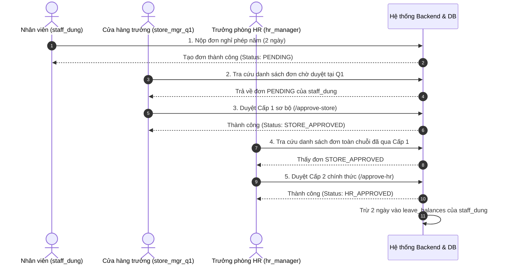

# BỘ TÀI LIỆU KIỂM THỬ TOÀN DIỆN HỆ THỐNG TECHZONE HRM
## (COMPREHENSIVE TEST SPECIFICATION & TEST CASES DOCUMENT)

* **Dự án:** Hệ thống Thông tin Quản lý Nhân sự Đa nền tảng Chuỗi Cửa hàng Bán lẻ TechZone (TechZone HRM)
* **Đơn vị đào tạo:** Trường Đại học Sài Gòn (SGU) - Khoa Công nghệ Thông tin
* **Học phần:** Hệ thống thông tin doanh nghiệp (841065) & Công nghệ phần mềm (841403)
* **Nhóm tác giả:** Huỳnh Viễn Thông (Lead/Backend), Lê Phan Nguyên Hải (Frontend Web), Võ Hoàng Bảo (Mobile UX), Đoàn Trung Kiên (DB/Testing)
* **Ngày ban hành:** Tháng 10/2026
* **Phiên bản tài liệu:** v2.0 - Hoàn thiện toàn bộ các vai trò & chức năng

---

## MỤC LỤC TỔNG QUAN

1. [Tổng quan Phạm vi & Môi trường Kiểm thử](#1-tổng-quan-phạm-vi--môi-trường-kiểm-thử)
2. [Danh sách Tài khoản Kiểm thử Tiêu chuẩn (Test Accounts)](#2-danh-sách-tài-khoản-kiểm-thử-tiêu-chuẩn)
3. [Ma trận Phân quyền Chức năng theo Vai trò (RBAC Matrix)](#3-ma-trận-phân-quyền-chức-năng-theo-vai-trò-rbac-matrix)
4. [PHẦN I: TEST CASES CHO VAI TRÒ ADMIN (QUẢN TRỊ VIÊN)](#phần-i-test-cases-cho-vai-trò-admin)
5. [PHẦN II: TEST CASES CHO VAI TRÒ HR_MANAGER (TRƯỞNG PHÒNG NHÂN SỰ)](#phần-ii-test-cases-cho-vai-trò-hr_manager)
6. [PHẦN III: TEST CASES CHO VAI TRÒ STORE_MANAGER (CỬA HÀNG TRƯỞNG)](#phần-iii-test-cases-cho-vai-trò-store_manager)
7. [PHẦN IV: TEST CASES CHO VAI TRÒ EMPLOYEE (NHÂN VIÊN - ESS)](#phần-iv-test-cases-cho-vai-trò-employee)
8. [PHẦN V: KIỂM THỬ QUY TRÌNH NGHIỆP VỤ LIÊN VAI TRÒ (END-TO-END WORKFLOWS)](#phần-v-kiểm-thử-quy-trình-nghiệp-vụ-liên-vai-trò-e2e)
9. [PHẦN VI: KIỂM THỬ BẢO MẬT & XỬ LÝ NGOẠI LỆ (SECURITY & NEGATIVE CASES)](#phần-vi-kiểm-thử-bảo-mật--xử-lý-ngoại-lệ)

---

## 1. TỔNG QUAN PHẠM VI & MÔI TRƯỜNG KIỂM THỬ

### 1.1. Mục tiêu kiểm thử
* Xác thực toàn bộ tính năng đáp ứng chính xác đặc tả yêu cầu phần mềm (SRS) và các tiêu chí Rubric đánh giá đồ án.
* Đảm bảo tính toàn vẹn dữ liệu chuẩn 3NF, bảo mật phân quyền RBAC và không có xung đột lợi ích giữa các cấp quản lý.
* Kiểm tra tính đúng đắn của các Stored Procedures tính hoa hồng bán lẻ 3 ngành hàng, phạt đi muộn, trích bảo hiểm 10.5% và lương thực lĩnh NET.

### 1.2. Môi trường kiểm thử
* **Backend:** FastAPI v0.110+ (Python 3.11), SQLAlchemy 2.0 Async, Uvicorn (Port 8000).
* **Database:** Supabase Cloud PostgreSQL 15+ (Transaction / Session Pooler Port 5432).
* **Frontend Web:** React 18, TypeScript, Vite, TailwindCSS (Port 3000 / 5173).
* **Kiểm thử tự động:** `pytest`, `httpx` AsyncClient, `greenlet`.

---

## 2. DANH SÁCH TÀI KHOẢN KIỂM THỬ TIÊU CHUẨN

Tất cả các tài khoản thử nghiệm bên dưới đều sử dụng **Mật khẩu chung:** `123456`

| Username | Họ và tên | Chức danh | Vai trò (Role) | Chi nhánh / Đơn vị | Mục đích kiểm thử đại diện |
| :--- | :--- | :--- | :---: | :--- | :--- |
| `admin` | Quản trị viên TechZone | System Administrator | `ADMIN` | Trụ sở chính (HQ) | Cấu hình CSDL, quản lý User, gán Role, xem Audit Logs, Giám sát GPS |
| `hr_manager` | Huỳnh Thị Kim Yến | Trưởng phòng Nhân sự | `HR_MANAGER` | Phòng Nhân sự HQ | Tuyển dụng, ký HĐ, thăng chức đổi role, duyệt nghỉ phép Cấp 2, chốt lương tháng, xuất báo cáo |
| `store_mgr_q1` | Lê Hoàng Nam | Cửa hàng trưởng | `STORE_MANAGER` | TechZone Flagship Q1 | Phân ca kíp, duyệt phép Cấp 1, duyệt OT, nhập doanh số 3 ngành hàng, xem bảng lương Q1 |
| `staff_dung` | Trần Quốc Dũng | Chuyên viên Bán hàng | `EMPLOYEE` | TechZone Flagship Q1 | Check-in GPS, nộp đơn phép/OT, tự theo dõi doanh số 220tr, xem phiếu lương A4 |
| `tech_em` | Phan Thị Én | Kỹ thuật viên | `EMPLOYEE` | TechZone Quận 3 | Chấm công ca xoay, kiểm tra số dư phép năm, tra cứu phiếu lương cá nhân |

---

## 3. MA TRẬN PHÂN QUYỀN CHỨC NĂNG THEO VAI TRÒ (RBAC MATRIX)

> **Ký hiệu:**  
> • **`FULL`**: Toàn quyền (Tạo, Xem, Sửa, Xóa, Phê duyệt, Xuất dữ liệu).  
> • **`BRANCH`**: Giới hạn quyền trong phạm vi Cửa hàng / Chi nhánh được phân công phụ trách.  
> • **`OWN`**: Chỉ có quyền thao tác trên dữ liệu của chính bản thân mình (Self-service).  
> • **`NONE`**: Bị cấm truy cập (Backend trả về HTTP `403 Forbidden`).

| Phân hệ / Chức năng | Đường dẫn (URL Path) | ADMIN | HR_MANAGER | STORE_MANAGER | EMPLOYEE |
| :--- | :--- | :---: | :---: | :---: | :---: |
| **Xác thực & Cá nhân** | `/api/v1/auth/login`, `/me` | `FULL` | `FULL` | `FULL` | `FULL` |
| **Quản lý Cửa hàng & GPS** | `/api/v1/stores`, `/stores` | `FULL` | `VIEW` | `VIEW_OWN` | `NONE` |
| **Tài khoản & Phân quyền** | `/api/v1/users`, `/api/v1/roles` | `FULL` | `FULL` | `NONE` | `NONE` |
| **Nhật ký Kiểm toán (Audit)**| `/api/v1/audit-logs`, `/audit` | `FULL` | `FULL` | `NONE` | `NONE` |
| **Hồ sơ Nhân sự** | `/api/v1/employees` | `FULL` | `FULL` | `BRANCH` | `NONE` |
| **Hợp đồng Lao động** | `/api/v1/contracts` | `FULL` | `FULL` | `BRANCH` | `OWN` |
| **Thăng chức & Đổi Role** | `/api/v1/employees/promotions` | `FULL` | `FULL` | `NONE` | `NONE` |
| **Đơn Thôi việc** | `/api/v1/resignations` | `FULL` | `FULL` | `BRANCH` | `OWN` |
| **Lịch làm việc & Phân ca** | `/api/v1/work-schedules` | `FULL` | `FULL` | `BRANCH` | `OWN` |
| **Chấm công & Điểm danh** | `/api/v1/attendances`, `/mobile-attendance`| `FULL` | `FULL` | `BRANCH` | `OWN` |
| **Duyệt Nghỉ phép Cấp 1** | `/leaves/{id}/approve-store` | `FULL` | `FULL` | `BRANCH` | `NONE` |
| **Duyệt Nghỉ phép Cấp 2** | `/leaves/{id}/approve-hr` | `FULL` | `FULL` | `NONE` | `NONE` |
| **Đơn phép Cá nhân (ESS)** | `/leaves/me`, `/leaves/apply` | `OWN` | `OWN` | `OWN` | `OWN` |
| **Đăng ký & Duyệt OT** | `/api/v1/overtime-requests` | `FULL` | `FULL` | `BRANCH` | `OWN` |
| **Nhập Doanh số Bán lẻ** | `/api/v1/payrolls/sales-records` | `FULL` | `FULL` | `BRANCH` | `NONE` |
| **Tính toán & Chốt lương** | `/api/v1/payrolls/calculate`, `confirm-all` | `FULL` | `FULL` | `NONE` | `NONE` |
| **Xem Bảng lương** | `/api/v1/payrolls` | `FULL` | `FULL` | `BRANCH` | `OWN` |
| **In Phiếu lương A4** | `/api/v1/payrolls/{id}/payslip` | `FULL` | `FULL` | `BRANCH` | `OWN` |
| **Dự án Mở điểm bán** | `/api/v1/payrolls/projects` | `FULL` | `FULL` | `VIEW` | `VIEW_OWN` |
| **Báo cáo & Dashboard KPI** | `/api/v1/reports` | `FULL` | `FULL` | `BRANCH` | `NONE` |
| **Xuất Excel & CSV** | `/export/excel`, `/export/csv` | `FULL` | `FULL` | `NONE` | `NONE` |

---

## PHẦN I: TEST CASES CHO VAI TRÒ ADMIN

### TC_ADM_01: Đăng nhập Quản trị viên thành công
* **Mục tiêu:** Kiểm tra cơ chế cấp phát JWT Token và thông tin phân quyền của Admin.
* **Tiền điều kiện:** Tài khoản `admin` ở trạng thái kích hoạt (`is_active = true`).
* **Các bước thực hiện:**
  1. Gửi request `POST /api/v1/auth/login` với body: `{"username": "admin", "password": "123456"}`.
* **Kết quả mong đợi:**
  - HTTP `200 OK`.
  - Trả về `access_token`, `token_type: "bearer"`.
  - Mảng `roles` chứa `"ADMIN"`.
  - Thời hạn token: 480 phút.

### TC_ADM_02: Tạo tài khoản người dùng mới và mã hóa mật khẩu Bcrypt
* **Mục tiêu:** Đảm bảo tài khoản mới được lưu an toàn, mật khẩu không bị lưu dạng plaintext.
* **Tiền điều kiện:** Đã đăng nhập tài khoản `admin`.
* **Các bước thực hiện:**
  1. `POST /api/v1/users` kèm payload: `{"username": "nv_moi", "password": "Password123@", "email": "nv_moi@techzone.vn", "role_ids": [4]}`.
  2. Truy vấn trực tiếp CSDL Supabase bảng `users`.
* **Kết quả mong đợi:**
  - HTTP `201 Created`.
  - Password trong CSDL bắt đầu bằng `$2b$` (Bcrypt hash).
  - Tự động ghi 1 dòng vào `audit_logs` với action `CREATE_USER`.

### TC_ADM_03: Gán vai trò (Roles) và cập nhật quyền hạn người dùng
* **Mục tiêu:** Kiểm tra chức năng cập nhật quyền RBAC động.
* **Tiền điều kiện:** Đã có tài khoản `nv_moi` trong hệ thống.
* **Các bước thực hiện:**
  1. `PUT /api/v1/users/{user_id}/roles` với body `{"role_ids": [3]}` (Gán role STORE_MANAGER).
* **Kết quả mong đợi:**
  - HTTP `200 OK`.
  - User `nv_moi` đăng nhập lại có vai trò `STORE_MANAGER`.

### TC_ADM_04: Khóa tài khoản người dùng vi phạm kỷ luật
* **Mục tiêu:** Ngăn chặn đăng nhập ngay lập tức đối với tài khoản bị vô hiệu hóa.
* **Các bước thực hiện:**
  1. `PATCH /api/v1/users/{user_id}/status` với body `{"is_active": false}`.
  2. Thử dùng tài khoản đó đăng nhập `POST /api/v1/auth/login`.
* **Kết quả mong đợi:**
  - Bước 1: HTTP `200 OK`, `is_active = false`.
  - Bước 2: HTTP `400 Bad Request` hoặc `401 Unauthorized` kèm thông báo *"Tài khoản đã bị khóa hoặc ngừng hoạt động"*.

### TC_ADM_05: Cấu hình tọa độ GPS Geofence cho Chi nhánh cửa hàng
* **Mục tiêu:** Thiết lập tọa độ chuẩn vĩ độ, kinh độ và bán kính điểm danh di động.
* **Các bước thực hiện:**
  1. `PUT /api/v1/stores/{store_id}` với payload: `{"latitude": 10.762622, "longitude": 106.682245, "geofence_radius": 200}`.
* **Kết quả mong đợi:**
  - HTTP `200 OK`.
  - Bảng `stores` cập nhật tọa độ và bán kính 200m.
  - Nhân viên chi nhánh chỉ có thể điểm danh trong bán kính này.

### TC_ADM_06: Tra cứu Nhật ký Kiểm toán hệ thống (Audit Logs)
* **Mục tiêu:** Thanh tra các thao tác nhạy cảm (sửa lương, duyệt phép, thăng chức).
* **Các bước thực hiện:**
  1. `GET /api/v1/audit-logs?limit=20`.
* **Kết quả mong đợi:**
  - HTTP `200 OK`.
  - Danh sách bản ghi chứa: `user_id`, `action`, `table_name`, `record_id`, `old_values` (JSONB), `new_values` (JSONB), `timestamp`.

### TC_ADM_07: Xem Ma trận Phân quyền toàn hệ thống (RBAC Matrix)
* **Các bước thực hiện:**
  1. `GET /api/v1/roles/matrix`.
* **Kết quả mong đợi:**
  - HTTP `200 OK`.
  - Trả về danh sách tất cả các quyền (Permissions) và các vai trò tương ứng được tích hợp.

---

## PHẦN II: TEST CASES CHO VAI TRÒ HR_MANAGER

### TC_HRM_01: Tiếp nhận nhân sự mới & Tự động sinh mã nhân viên chuẩn
* **Mục tiêu:** Tạo hồ sơ nhân viên và kiểm tra sinh mã tự động `TZ-xxx`.
* **Tiền điều kiện:** Đăng nhập `hr_manager`.
* **Các bước thực hiện:**
  1. `POST /api/v1/employees` với thông tin: Họ tên: "Nguyễn Văn An", Ngày sinh: "1998-05-12", CMND/CCCD: "079098001234", Vị trí: Nhân viên bán hàng, Cửa hàng: Q1.
* **Kết quả mong đợi:**
  - HTTP `201 Created`.
  - Trường `employee_code` được tạo tự động có định dạng `TZ-xxx` (tự tăng).
  - Trạng thái `status = "PROBATION"` (thử việc) hoặc `"ACTIVE"`.

### TC_HRM_02: Tạo mới Hợp đồng Lao động & Sinh mã tự động
* **Mục tiêu:** Khởi tạo hợp đồng lao động và kiểm tra định dạng mã hợp đồng.
* **Các bước thực hiện:**
  1. `POST /api/v1/contracts` kèm payload: `employee_id`, `contract_type: "XAC_DINH_THOI_HAN"`, `basic_salary: 8000000`, `insurance_salary: 5000000`, `start_date: "2026-11-01"`, `end_date: "2027-10-31"`.
* **Kết quả mong đợi:**
  - HTTP `201 Created`.
  - Mã hợp đồng sinh dạng: `HDLD-TZ-xxx-2026`.
  - Bảng lương sau này sẽ lấy `contract_salary` và `insurance_salary` từ hợp đồng này.

### TC_HRM_03: Thăng chức Bổ nhiệm & Tự động chuyển đổi vai trò RBAC
* **Mục tiêu:** Xác minh nghiệp vụ: Nhân viên bán hàng được thăng lên Cửa hàng trưởng thì tài khoản User tự động có role `STORE_MANAGER`.
* **Các bước thực hiện:**
  1. `POST /api/v1/employees/promotions` với body: `{"employee_id": 4, "new_position_id": 3, "effective_date": "2026-11-01", "decision_number": "QD-TC-2026-01"}`.
  2. Kiểm tra lại bảng `user_roles` của user tương ứng với `employee_id = 4`.
* **Kết quả mong đợi:**
  - HTTP `200 OK`.
  - Bảng `position_histories` được ghi nhận lịch sử chức vụ mới.
  - Quyền hạn của user tự động cập nhật thêm role `STORE_MANAGER`.

### TC_HRM_04: Duyệt Đơn Nghỉ Phép Cấp 2 (Chính thức)
* **Mục tiêu:** Trưởng phòng HR duyệt phê duyệt cấp cuối cho đơn nghỉ phép chi nhánh đã qua Cấp 1.
* **Tiền điều kiện:** Đơn nghỉ phép có trạng thái `STORE_APPROVED`.
* **Các bước thực hiện:**
  1. `POST /api/v1/leaves/{leave_id}/approve-hr` với `{"comment": "Đồng ý cho nghỉ phép năm"}`.
* **Kết quả mong đợi:**
  - HTTP `200 OK`.
  - `status` chuyển thành `HR_APPROVED`.
  - Số ngày nghỉ được trừ vào `used_days` trong bảng `leave_balances`.

### TC_HRM_05: Duyệt Đơn Thôi Việc & Tự động khóa tài khoản
* **Mục tiêu:** Khi HR duyệt đơn thôi việc, nhân viên chuyển sang trạng thái `RESIGNED` và tài khoản phần mềm bị khóa.
* **Các bước thực hiện:**
  1. Nhân viên nộp đơn thôi việc loại `THOI_VIEC`.
  2. HR duyệt: `POST /api/v1/resignations/{id}/approve` hoặc duyệt đơn leave loại thôi việc.
* **Kết quả mong đợi:**
  - HTTP `200 OK`.
  - Hồ sơ nhân viên: `employees.status = "RESIGNED"`.
  - Tài khoản người dùng: `users.is_active = false`.

### TC_HRM_06: Quản lý Danh mục Dự án Mở điểm bán (MOD-07)
* **Các bước thực hiện:**
  1. `POST /api/v1/payrolls/projects` tạo dự án "Khai trương TechZone Quận 7".
  2. `POST /api/v1/payrolls/projects/{id}/members` gán nhân viên kèm `allowance_amount: 1500000`.
* **Kết quả mong đợi:**
  - HTTP `201 Created`.
  - Khi chạy bảng lương tháng đó, nhân viên sẽ tự động nhận thêm phụ cấp dự án 1.500.000đ.

### TC_HRM_07: Chạy Động cơ Tính lương tháng tự động toàn chuỗi
* **Mục tiêu:** Kích hoạt Stored Procedure `sp_generate_monthly_payroll`.
* **Các bước thực hiện:**
  1. `POST /api/v1/payrolls/calculate` với body `{"period": "2026-10"}`.
* **Kết quả mong đợi:**
  - HTTP `200 OK`.
  - Tất cả nhân sự active toàn chuỗi được tạo bản ghi lương `DRAFT`.
  - Tự động sinh đầy đủ 12 dòng giải trình cấu phần lương trong `payroll_details`.
  - Tính chính xác: Lương CB trừ giờ đi trễ/nghỉ, tiền OT x1.5, 3 loại phụ cấp, hoa hồng doanh số, bảo hiểm 10.5%.

### TC_HRM_08: Phê duyệt Chốt Bảng lương Hàng loạt (Confirm All)
* **Các bước thực hiện:**
  1. `POST /api/v1/payrolls/confirm-all?period=2026-10`.
* **Kết quả mong đợi:**
  - HTTP `200 OK`.
  - Tất cả các phiếu lương từ `DRAFT` chuyển sang trạng thái `CONFIRMED`.
  - Cửa hàng trưởng và Nhân viên bắt đầu xem được phiếu lương chính thức.

### TC_HRM_09: Xác nhận Thanh toán Chuyển khoản Lương Toàn chuỗi (Pay All)
* **Các bước thực hiện:**
  1. `POST /api/v1/payrolls/pay-all?period=2026-10`.
* **Kết quả mong đợi:**
  - HTTP `200 OK`.
  - `payment_status` chuyển thành `PAID`.
  - Ghi nhận `paid_at = CURRENT_TIMESTAMP`.

### TC_HRM_10: Xem Báo cáo Biến động Nhân sự Tháng (View v_monthly_hr_status_report)
* **Các bước thực hiện:**
  1. `GET /api/v1/reports/monthly-status?period=2026-10`.
* **Kết quả mong đợi:**
  - HTTP `200 OK`.
  - Trả về tỷ lệ % nhân viên active, thử việc, thai sản, thôi việc và biểu đồ xu hướng 6 tháng.

### TC_HRM_11: Xem Báo cáo Cơ cấu Nhân sự Đa chiều (View v_hr_demographics_report)
* **Các bước thực hiện:**
  1. `GET /api/v1/reports/demographics`.
* **Kết quả mong đợi:**
  - HTTP `200 OK`.
  - Phân tích 3 chiều: Trình độ học vấn (Đại học/Cao đẳng/...), Bậc lương (<7tr, 7-12tr, 12-20tr, >20tr), Thâm niên công tác.

### TC_HRM_12: Xuất Báo cáo Quỹ lương & Nhân sự ra file Excel chuyên nghiệp
* **Các bước thực hiện:**
  1. `GET /api/v1/payrolls/export/excel?period=2026-10`.
  2. `GET /api/v1/reports/export/demographics/excel`.
* **Kết quả mong đợi:**
  - HTTP `200 OK`.
  - Trả về file nhị phân `application/vnd.openxmlformats-officedocument.spreadsheetml.sheet`.
  - Mở file Excel có tiêu đề chuẩn màu TechZone Navy Blue, định dạng số tiền VND và hàng Tổng cộng tính tổng chính xác.

---

## PHẦN III: TEST CASES CHO VAI TRÒ STORE_MANAGER

### TC_STM_01: Đăng nhập Cửa hàng trưởng và Kiểm tra Phạm vi Dữ liệu (Branch Scoping)
* **Mục tiêu:** CHT chỉ được xem dữ liệu nhân sự thuộc cửa hàng mình quản lý.
* **Tiền điều kiện:** Đăng nhập tài khoản `store_mgr_q1` (phụ trách Store ID 1).
* **Các bước thực hiện:**
  1. `GET /api/v1/employees`.
* **Kết quả mong đợi:**
  - HTTP `200 OK`.
  - 100% nhân viên trả về trong danh sách có `store_id = 1`.
  - Tuyệt đối không thấy nhân viên chi nhánh Quận 3 hay Quận 6.

### TC_STM_02: Phân ca làm việc xoay ca hàng tuần cho nhân viên chi nhánh
* **Mục tiêu:** Xếp ca Sáng (08:00 - 16:00), Chiều (13:00 - 21:00) cho nhân sự.
* **Các bước thực hiện:**
  1. `POST /api/v1/work-schedules` với payload: `{"employee_id": 4, "shift_id": 1, "work_date": "2026-11-02"}`.
* **Kết quả mong đợi:**
  - HTTP `201 Created`.
  - Nhân viên thấy ca làm việc mới trên giao diện lịch cá nhân.

### TC_STM_03: Chặn phân ca trùng lặp hoặc vi phạm nghỉ giữa 2 ca
* **Mục tiêu:** Tránh xếp ca chồng chéo cho 1 nhân viên trong cùng 1 ngày.
* **Các bước thực hiện:**
  1. Tiếp tục xếp thêm ca khác cho `employee_id = 4` cùng ngày `2026-11-02` bị trùng thời gian.
* **Kết quả mong đợi:**
  - HTTP `400 Bad Request`.
  - Thông báo: *"Nhân viên đã được xếp ca trong khung giờ này"*.

### TC_STM_04: Duyệt Đơn Nghỉ Phép Cấp 1 (Sơ bộ Chi nhánh)
* **Mục tiêu:** Cửa hàng trưởng kiểm tra ca kíp chi nhánh và duyệt sơ bộ cấp 1.
* **Tiền điều kiện:** Có đơn nghỉ phép `PENDING` của nhân viên chi nhánh Q1.
* **Các bước thực hiện:**
  1. `POST /api/v1/leaves/{id}/approve-store` kèm `{"comment": "Đã bố trí người trực thay"}`.
* **Kết quả mong đợi:**
  - HTTP `200 OK`.
  - Trạng thái đơn chuyển sang `STORE_APPROVED`.
  - Đơn được chuyển tiếp lên hàng đợi của Trưởng phòng HR để duyệt Cấp 2.

### TC_STM_05: Từ chối Đơn Nghỉ Phép Cấp 1 do thiếu quân số
* **Các bước thực hiện:**
  1. `POST /api/v1/leaves/{id}/reject` kèm lý do: `{"reject_reason": "Chi nhánh đang thiếu nhân sự cuối tuần"}`.
* **Kết quả mong đợi:**
  - HTTP `200 OK`.
  - `status` chuyển thành `REJECTED`.
  - Tiến trình dừng lại, không chuyển lên HR.

### TC_STM_06: Kiểm tra Chặn Xung đột Lợi ích (Không tự duyệt đơn của mình)
* **Mục tiêu:** Cửa hàng trưởng không được tự duyệt đơn nghỉ phép hoặc đơn OT do chính mình nộp.
* **Các bước thực hiện:**
  1. CHT nộp đơn xin nghỉ phép cá nhân (tạo ra đơn có `employee_id` của CHT).
  2. CHT gọi API `/approve-store` trên chính đơn đó.
* **Kết quả mong đợi:**
  - HTTP `403 Forbidden` hoặc `400 Bad Request`.
  - Báo lỗi: *"Cửa hàng trưởng không được tự phê duyệt đơn của chính mình. Đơn phải được chuyển thẳng lên Trưởng phòng HR"*.

### TC_STM_07: Duyệt Đơn Đăng ký Tăng ca (Overtime Request)
* **Các bước thực hiện:**
  1. `POST /api/v1/overtime-requests/{id}/approve`.
* **Kết quả mong đợi:**
  - HTTP `200 OK`.
  - Giờ làm thêm được ghi nhận hợp lệ để đưa vào đối soát tính lương OT x1.5.

### TC_STM_08: Nhập Doanh số Bán lẻ 3 Ngành hàng cho Nhân viên
* **Mục tiêu:** Ghi nhận doanh thu thực tế theo đúng chính sách hoa hồng TechZone.
* **Các bước thực hiện:**
  1. `POST /api/v1/payrolls/sales-records` kèm dữ liệu:
     - `employee_id: 4` (Trần Quốc Dũng)
     - `period: "2026-10"`
     - `phones_revenue: 150000000` (150 triệu)
     - `laptops_tablets_revenue: 60000000` (60 triệu)
     - `accessories_revenue: 30000000` (30 triệu)
     - `kpi_target: 200000000` (KPI 200 triệu $\rightarrow$ đạt 240tr = 120%)
* **Kết quả mong đợi:**
  - HTTP `201 Created`.
  - Hệ thống tự động tính hoa hồng:
    + ĐT (1%): 1.500.000đ
    + Laptop (1%): 600.000đ
    + Phụ kiện (3%): 900.000đ
    + Tổng hoa hồng: 3.000.000đ
    + Thưởng nóng vượt 120% KPI: 2.000.000đ.

### TC_STM_09: Xem Bảng lương Nhân viên trong phạm vi Cửa hàng mình
* **Các bước thực hiện:**
  1. `GET /api/v1/payrolls?period=2026-10`.
* **Kết quả mong đợi:**
  - HTTP `200 OK`.
  - Chỉ thấy các bản ghi lương của nhân viên Store 1.
  - Không truy xuất được lương của nhân viên Store khác.

---

## PHẦN IV: TEST CASES CHO VAI TRÒ EMPLOYEE

### TC_EMP_01: Điểm danh vào ca (Check-in) đúng vị trí GPS trong Geofence
* **Mục tiêu:** Nhân viên chấm công di động thành công khi có mặt tại cửa hàng.
* **Tiền điều kiện:** Đăng nhập tài khoản `staff_dung`, có ca làm việc ngày hôm nay.
* **Các bước thực hiện:**
  1. Gửi request `POST /api/v1/mobile-attendance/check-in` kèm tọa độ: `latitude: 10.762622, longitude: 106.682245` (tọa độ khớp chi nhánh Q1).
* **Kết quả mong đợi:**
  - HTTP `200 OK`.
  - Ghi nhận `check_in_time`.
  - Trạng thái chấm công: `ON_TIME` (nếu đến đúng giờ) hoặc `LATE` (nếu trễ).
  - Khoảng cách GPS tính toán $\le$ bán kính cho phép.

### TC_EMP_02: Chặn Điểm danh khi nằm ngoài bán kính GPS Geofence
* **Mục tiêu:** Ngăn chặn gian lận chấm công từ xa.
* **Các bước thực hiện:**
  1. Gửi tọa độ ở vị trí cách xa 5km: `latitude: 10.823099, longitude: 106.629664`.
* **Kết quả mong đợi:**
  - HTTP `400 Bad Request`.
  - Báo lỗi: *"Bạn đang ở ngoài phạm vi cửa hàng (Cách 5.2 km > Bán kính cho phép 200m). Không thể chấm công!"*.

### TC_EMP_03: Chấm công Đi muộn > 15 phút & Phạt quy định
* **Mục tiêu:** Kiểm tra cơ chế phạt đi trễ 50.000đ và trừ lương theo phút.
* **Các bước thực hiện:**
  1. Ca làm việc 08:00. Nhân viên check-in lúc 08:25 (trễ 25 phút).
* **Kết quả mong đợi:**
  - `status = "LATE"`.
  - `late_minutes = 25`.
  - Khi tính lương: Tự động ghi khoản phạt 50.000đ và trừ unworked time theo 25 phút.

### TC_EMP_04: Điểm danh tan ca (Check-out)
* **Các bước thực hiện:**
  1. `POST /api/v1/mobile-attendance/check-out` kèm tọa độ GPS hợp lệ.
* **Kết quả mong đợi:**
  - HTTP `200 OK`.
  - Cập nhật `check_out_time`.
  - Tự động tính tổng số giờ làm việc thực tế (`work_hours`).

### TC_EMP_05: Tra cứu Số dư Phép năm Cá nhân (Leave Balance)
* **Các bước thực hiện:**
  1. `GET /api/v1/leaves/balances/me`.
* **Kết quả mong đợi:**
  - HTTP `200 OK`.
  - Trả về: `entitled_days` (12 ngày cơ bản + ngày thưởng thâm niên), `used_days`, `remaining_days`.

### TC_EMP_06: Nộp Đơn xin Nghỉ phép năm hợp lệ
* **Các bước thực hiện:**
  1. `POST /api/v1/leaves/apply` với: `leave_type_code: "PHEP_NAM"`, `start_date: "2026-11-10"`, `end_date: "2026-11-11"`, `reason: "Về quê giải quyết việc gia đình"`.
* **Kết quả mong đợi:**
  - HTTP `201 Created`.
  - `status = "PENDING"`.
  - Số ngày nghỉ tính toán: 2 ngày.

### TC_EMP_07: Chặn Nộp Đơn Nghỉ Phép vượt quá số dư phép năm
* **Mục tiêu:** Kiểm tra tính toàn vẹn số ngày phép.
* **Tiền điều kiện:** Nhân viên chỉ còn 2 ngày phép năm.
* **Các bước thực hiện:**
  1. Nộp đơn xin nghỉ 5 ngày phép năm.
* **Kết quả mong đợi:**
  - HTTP `400 Bad Request`.
  - Báo lỗi: *"Số ngày nghỉ đề xuất (5 ngày) vượt quá số dư phép năm khả dụng (2 ngày)"*.

### TC_EMP_08: Chặn Nộp Đơn có Ngày bắt đầu lớn hơn Ngày kết thúc
* **Các bước thực hiện:**
  1. Nộp đơn với `start_date: "2026-11-15"` và `end_date: "2026-11-12"`.
* **Kết quả mong đợi:**
  - HTTP `422 Unprocessable Entity` hoặc `400 Bad Request`.
  - Báo lỗi: *"Ngày bắt đầu nghỉ phép không được lớn hơn ngày kết thúc"*.

### TC_EMP_09: Chủ động Hủy Đơn Nghỉ Phép khi còn ở trạng thái PENDING
* **Các bước thực hiện:**
  1. `POST /api/v1/leaves/{id}/cancel`.
* **Kết quả mong đợi:**
  - HTTP `200 OK`.
  - `status` chuyển thành `CANCELLED`.
  - Nếu đơn trước đó đã trừ tạm số dư thì hệ thống hoàn lại số ngày phép.

### TC_EMP_10: Đăng ký Tăng ca (OT Request) trước giờ Cutoff
* **Các bước thực hiện:**
  1. `POST /api/v1/overtime-requests` đăng ký làm thêm 2 giờ sau ca chính.
* **Kết quả mong đợi:**
  - HTTP `201 Created`, trạng thái `PENDING` chờ Cửa hàng trưởng duyệt.

### TC_EMP_11: Tra cứu Doanh số & Tiến độ đạt KPI Cá nhân (Sales Tracking)
* **Các bước thực hiện:**
  1. `GET /api/v1/payrolls/sales-records/me`.
* **Kết quả mong đợi:**
  - HTTP `200 OK`.
  - Xem được tổng doanh thu tháng, tỷ lệ % đạt KPI (ví dụ: 120%), số tiền hoa hồng ước tính nhận được.

### TC_EMP_12: Xem Phiếu lương Cá nhân & Bản in A4 tiếng Việt
* **Mục tiêu:** Nhân viên tra cứu minh bạch 12 cấu phần lương và đọc tiền Net bằng chữ.
* **Các bước thực hiện:**
  1. `GET /api/v1/payrolls/{payroll_id}/payslip`.
* **Kết quả mong đợi:**
  - HTTP `200 OK`.
  - Hiển thị chi tiết: Lương hợp đồng, Lương CB thực hưởng, Tiền OT, 3 Phụ cấp, Thưởng KPI, Hoa hồng, Trích BH 10.5%, Phạt trễ, Thực lĩnh (Net).
  - Trường `net_salary_in_words` đọc chuẩn tiếng Việt: Ví dụ *"Hai mươi bảy triệu bảy trăm hai mươi hai nghìn năm trăm đồng"*.

---

## PHẦN V: KIỂM THỬ QUY TRÌNH NGHIỆP VỤ LIÊN VAI TRÒ (E2E)

### E2E_WF_01: Quy trình Phê duyệt Nghỉ phép 2 Cấp (Level-1 $\rightarrow$ Level-2)

### E2E_WF_02: Quy trình Bán hàng $\rightarrow$ Tính hoa hồng $\rightarrow$ Chốt lương tháng
1. **Bước 1 (Doanh số):** CHT nhập doanh số tháng 10 cho `staff_dung`: ĐT 150tr, Laptop 60tr, Phụ kiện 30tr, KPI 200tr (Đạt 120%).
2. **Bước 2 (Chấm công):** `staff_dung` đi làm đủ 26 công chuẩn, tăng ca 10 giờ OT, đi muộn 1 lần 20 phút.
3. **Bước 3 (Động cơ lương):** HR bấm `POST /api/v1/payrolls/calculate?period=2026-10`.
4. **Bước 4 (Đối soát kết quả):**
   - Lương CB hợp đồng: 12.000.000đ.
   - Tiền phạt đi trễ: 50.000đ.
   - Trừ thời gian đi trễ 20 phút: $\approx 19.230$đ.
   - Tiền làm thêm giờ OT (10h x đơn giá giờ x 1.5): $\approx 865.385$đ.
   - Phụ cấp cơm xe: 1.000.000đ.
   - Thưởng lễ theo hệ số chức vụ (1.00): 1.000.000đ.
   - Hoa hồng bán lẻ 3 ngành hàng: 3.000.000đ.
   - Thưởng nóng vượt 120% KPI: 2.000.000đ.
   - Trích bảo hiểm 10.5% (trên lương bảo hiểm): 630.000đ.
   - **Thực lĩnh NET:** Khớp 100% công thức doanh nghiệp.
5. **Bước 5 (Duyệt & Thanh toán):** HR bấm `confirm-all` $\rightarrow$ `pay-all`.

---

## PHẦN VI: KIỂM THỬ BẢO MẬT & XỬ LÝ NGOẠI LỆ

| Mã Test Case | Loại tấn công / Ngoại lệ | Dữ liệu đầu vào (Payload) | Hành vi mong đợi của Hệ thống |
| :--- | :--- | :--- | :--- |
| **TC_SEC_01** | Bẻ khóa phân quyền IDOR | `staff_dung` gọi `GET /api/v1/payrolls/1` (Phiếu lương của nhân viên khác) | HTTP `403 Forbidden` - Chặn xem lương người khác |
| **TC_SEC_02** | Xâm nhập trái quyền Admin | `staff_dung` gọi `POST /api/v1/users` tạo tài khoản | HTTP `403 Forbidden` - *"Yêu cầu vai trò ADMIN"* |
| **TC_SEC_03** | Token giả mạo hoặc hết hạn | Gửi Bearer Token sai chữ ký hoặc quá hạn 480 phút | HTTP `401 Unauthorized` - Token không hợp lệ |
| **TC_SEC_04** | SQL Injection | `GET /api/v1/employees?search=' OR '1'='1` | Không bị rò rỉ dữ liệu, tham số hóa an toàn qua SQLAlchemy ORM |
| **TC_SEC_05** | Gian lận Mock GPS Location | Gửi tọa độ GPS nhảy vọt 500km trong 10 giây | Hệ thống phát hiện bất thường và từ chối chấm công |
| **TC_SEC_06** | Xung đột đồng thời (Concurrency) | 2 yêu cầu check-in gửi cùng 1 tích tắc milli-giây | CSDL xử lý cô lập (ACID), chỉ chấp nhận 1 bản ghi chấm công duy nhất |
| **TC_SEC_07** | Nhập số âm lương / doanh số | `POST /sales-records` với doanh số `-50000000` | HTTP `422 Unprocessable Entity` (Pydantic validator chặn số âm) |
| **TC_SEC_08** | CHT duyệt lương nhân viên chi nhánh khác | `store_mgr_q1` gọi `GET /payrolls?store_id=2` | Danh sách trả về rỗng hoặc HTTP `403 Forbidden` |

---
*Tài liệu này được biên soạn cho mục đích nghiệm thu đồ án tốt nghiệp / báo cáo môn học Hệ thống thông tin doanh nghiệp & Công nghệ phần mềm tại Đại học Sài Gòn (SGU).*
